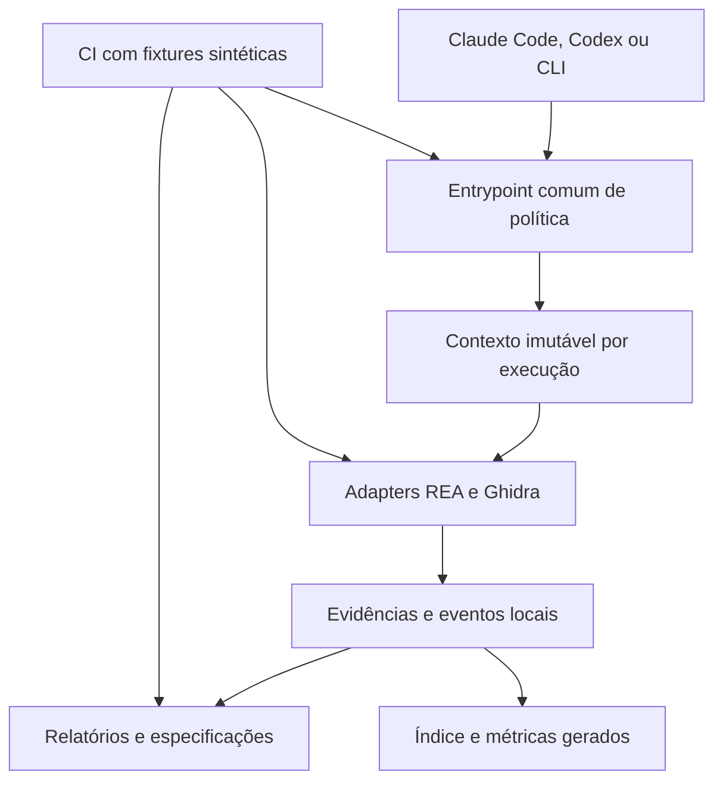

# PRKing_REA — análise de arquitetura, qualidade e direção técnica

Data: 01/11/2026 · Base local: `0146a9494eae87d4637edba0b62482068730c62f`.

## 1. Parecer executivo

O PRKing_REA já tem um método consistente para transformar investigação de software em conhecimento rastreável e especificações de comportamento. Seu maior valor está na combinação de protocolos, evidências, sala limpa e validação experimental. O REA e o Ghidra são motores externos desse processo.

Minha recomendação como arquiteto e CTO é **consolidar uma plataforma local de investigação reproduzível**, preservando a arquitetura atual e investindo primeiro em controles independentes do cliente de IA, identidade por execução e automação de qualidade. Ampliar a quantidade de ferramentas antes disso aumenta o trabalho de manutenção e as possibilidades de erro.

Há bons testes, mas a base inteira não está verde: nesta revisão passaram 164 testes JavaScript e 137 testes do núcleo .NET; a interface WPF teve 72 aprovações e quatro falhas, repetidas isoladamente. Também foi reproduzida uma falha no tratamento de WAV truncado pelo organizador de assets.

Não encontrei evidência que justifique reescrever o sistema, criar microsserviços ou adotar um banco remoto. Também não há medição suficiente para prometer uma redução percentual de custo, tempo ou tokens.

## 2. Escopo e confiança

- **Verificado:** leitura de configurações versionadas, gates e testes, scripts de assets, monetização e Semgrep, estrutura dos produtos, stories, protocolos e documentação; execução das verificações descritas na seção 5.
- **Verificado por reprodução sintética:** comportamento dos gates diante de ausência de identidade do programa e de hash não conferido; falha de parsing de um arquivo RIFF/WAVE truncado. Nenhum binário de alvo foi executado.
- **Inferência arquitetural:** riscos de concorrência, desempenho em arquivos grandes e ganhos esperados com respostas menores e cache. Exigem testes ou medições próprios antes de dimensionar investimento.
- **Pesquisa externa:** seis repositórios oficiais no GitHub, seus READMEs e documentos indicados na seção 7. Recursos anunciados pelo upstream não foram instalados ou validados localmente.

A alteração preexistente em `CLAUDE.md` foi preservada. Esta entrega acrescenta apenas o relatório; não altera gates, aprovações, versões nem produtos e não publica no GitHub. Não foi realizada auditoria exaustiva de todas as funções nem revisão do histórico completo à procura de dados sensíveis.

As definições locais de AIOX mencionadas nas instruções (`.aiox-core/constitution.md` e persona de arquiteto) não estão neste checkout. A avaliação respeita as regras fornecidas e os mecanismos efetivamente encontrados, sem presumir que esses componentes do framework estejam instalados.

## 3. Objetivos e funcionamento

O projeto atende a quatro objetivos relacionados:

1. Investigar software sem código-fonte, começando por fontes e dados mais baratos e avançando para código e execução quando permitido.
2. Registrar conclusões com origem, limitações e níveis de confiança, incluindo mecânicas de jogos, assets e monetização.
3. Produzir especificações em palavras próprias para reimplementações independentes.
4. Testar o próprio método com produtos limpos, variantes plantadas e sessões de análise cega.

```mermaid
flowchart LR
    A[Objetivo e autorização] --> B[Protocolo por alvo]
    B --> C[Gates MCP e CLI no Claude Code]
    C --> D[REA e GhidraMCP]
    D --> E[Evidência bruta local em saidas]
    E --> F[Registros resumidos e conclusões]
    F --> G[Especificação de comportamento]
    G --> H[Reimplementação em sessão separada]
    H --> I[Testes de conformidade e invariância]
    I --> J[Melhorias do método]
```

| Área | Papel e característica |
|---|---|
| `.claude/skills/` | Protocolos de segurança, mecânicas, assets, monetização, benchmark e especificação; skill do REA copiada da versão instalada |
| `.claude/hooks/` | Autorização por nível e restrição de caminhos; mapas por servidor; regressões sintéticas |
| `.mcp.json` | REA local por Node; GhidraMCP por `uvx`, com commit e duas dependências explicitamente fixados |
| `registros/` | Relatórios públicos, modelos, especificações e ponteiro global `ALVO_ATIVO` |
| `alvos/`, `saidas/`, `.rea/` | Dados locais excluídos do Git por padrão; exclusão do Git não equivale a isolamento do processo |
| `scripts/` | Organização de assets, checagem de monetização, Semgrep e auxiliares de RE/instalação |
| `reimplementacoes/notepad/` | Produto C#/.NET 10 e WPF; separação entre núcleo, interface e testes |
| `reimplementacoes/puzzle-piloto/` | ESM sem dependências próprias de runtime, núcleo puro, monetização simulada, sessão, simulação e interface |
| `pilotos/` | Fixtures e plantios para avaliar o processo; separados dos produtos |
| `docs/` | Planos, stories, auditorias, pesquisa e handoffs |

O projeto Unity relacionado ao UO está fora deste repositório por decisão documentada. A arquitetura desse produto externo não foi avaliada aqui.

## 4. O que vale preservar

- **Separação entre mecanismo e política.** Motores de RE são dependências; autorização, publicação e fluxo de trabalho pertencem ao projeto.
- **Governança explícita.** Níveis N0–N4, confirmação para operações mais invasivas, ferramentas fixadas e distinção entre conteúdo do alvo e instruções.
- **Evidência e sala limpa.** Especificação como fronteira entre investigação e implementação; adendos e fontes documentados. Isso cria disciplina verificável, embora não seja por si só isolamento técnico nem uma conclusão jurídica.
- **Qualidade do puzzle.** Núcleo puro, relógio e SDK substituíveis, invariância e mutações são uma base muito boa para testar efeitos da monetização sobre o jogo.
- **Segurança de dados no Notepad.** Gravação por temporário com substituição e `Flush`, separação da lógica de codificação e serviços substituíveis nos testes.
- **Execução contida do Semgrep.** Imagem por digest, rede desativada, usuário sem privilégios e montagem somente para leitura.

O caminho de menor risco é fortalecer essas decisões e reduzir dependências de procedimentos manuais.

## 5. Verificações executadas

Ambiente observado: Node `v26.12.1`; .NET SDK `10.0.401`.

| Verificação | Resultado e limite |
|---|---|
| `npm test` | **164/164 aprovados**, sem ignorados; duração informada pelo runner: aproximadamente 7,56 s |
| Testes `PRKingNotepad.Core.Tests`, `--no-restore` | **137/137 aprovados** |
| Testes `PRKingNotepad.Ui.Tests`, `--no-restore` | **72/76 aprovados; quatro falhas** |
| Reexecução isolada das quatro falhas WPF, `--no-build --no-restore --filter ...` | **As mesmas quatro falharam** |
| `npm run check:monetizacao` | Aprovado |
| `node --check` em arquivos JS/MJS/CJS rastreados, excluindo `pilotos/` | **45 arquivos**, sem erro de sintaxe; não substitui lint ou análise de tipos |
| Disponibilidade do Docker | Daemon inacessível no ambiente; **Semgrep, testes de regras e mutações Semgrep não executados nesta revisão** |
| Scripts de lint e typecheck | Não definidos no `package.json`; não foi possível executar os gates genéricos AIOX por esses nomes |
| Hook Git | `core.hooksPath` aponta para `.githooks` neste clone; nenhuma mudança foi staged ou commitada para testar o hook |

As falhas WPF são:

1. `Cut_copy_and_delete_are_enabled_only_with_a_selection` — itens de menu habilitados quando deveriam estar desabilitados.
2. `Undo_is_enabled_only_when_there_is_something_to_undo` — habilitação de Desfazer divergente.
3. `Opening_a_file_cannot_be_undone` — a falha ocorre na habilitação do menu; a asserção anterior de `Editor.CanUndo` passa.
4. `Paste_is_enabled_only_with_text_on_the_clipboard` — Colar habilitado com imagem e sem texto no clipboard.

**Diagnóstico delimitado:** o resultado confirma uma divergência reproduzível na suíte deste ambiente. A concentração na habilitação dos menus torna o roteamento/reconsulta de comandos e o helper `Notepad.IsEnabled` pontos prioritários de investigação. Ainda não distingue defeito na aplicação de limitação do harness WPF. Não há evidência aqui de perda de arquivo ou de desfazer indevido do conteúdo aberto.

**Adendo de revisão — 01/11/2026:** a story NB5 registra UI 76/76 em duas execuções no QA de 22/10, com build não incremental e `--artifacts-path` externo. A conferência em `7626b03` não encontrou mudança versionada em `reimplementacoes/notepad/` desde `50770d5`. Assim, investigar primeiro build efetivamente testado, SDK/runtime e condições do desktop/clipboard; os resultados acima permanecem como observação da revisão, não evidência de defeito novo causado por mudança de código. A causa ainda não foi determinada. Esse diagnóstico foi incorporado à MEL-02 do [planejamento revisado](../planos/2026-11-01-evolucao-arquitetura-qualidade.md).

## 6. Problemas e melhorias priorizadas

Prioridades: P1 = resolver antes de ampliar o uso; P2 = próxima etapa; P3 = evolução. São prioridades desta avaliação, não incidentes de produção.

| ID | Prioridade e confiança | Evidência | Consequência e recomendação |
|---|---|---|---|
| A01 | **P1 · verificado** | `.claude/settings.json` liga os controles a `PreToolUse` do Claude Code e aos matchers `rea`, `ghidra`, `Bash` e `PowerShell`. Não há adaptador equivalente versionado para Codex neste checkout | A proteção local não acompanha automaticamente outro host, uma chamada direta ou um servidor com nome diferente. Colocar a política em um wrapper/proxy comum e testar cada integração. O hook continua útil como defesa adicional |
| A02 | **P1 · verificado; impacto concorrente inferido** | `rea-gate.mjs` consulta um único `registros/ALVO_ATIVO`; chamadas por `document` e Ghidra sem caminho não são vinculadas ao programa aberto | Outra sessão pode mudar o contexto; uma chamada sem caminho não comprova que o banco aberto corresponde ao alvo. Identificar cada execução por `run_id`, alvo, projeto do provider e hash; recusar identidade divergente |
| A03 | **P1 · verificado** | O gate lê `status`, níveis e caminhos, mas não confere o SHA-256 registrado. A reprodução sintética com conteúdo substituído e hash fictício retornou `allow` | O plano aprovado pode ser reutilizado para outro conteúdo no mesmo caminho. Conferir identidade na abertura/importação e usar cópia imutável por execução; evitar recalcular vários gigabytes a cada consulta |
| A04 | **P1 · verificado** | Não há workflows rastreados em `.github/`. `npm test` não inclui .NET nem Semgrep; quatro testes WPF falham | Um resultado verde no comando principal não representa toda a base. Criar CI por componente com resultado agregado e incluir checagens de publicação. Proteções remotas de branch não foram inspecionadas |
| A05 | **P2 · reproduzido** | `organizar-assets.mjs:66` lê um inteiro no offset 20 sem tamanho mínimo. Arquivo de 12 bytes `RIFF0000WAVE`, em `--simular`, termina com `ERR_OUT_OF_RANGE`, exit 1 e sem catálogo | Um asset inválido interrompe o lote. Validar cabeçalhos e chunks; registrar erro por arquivo e continuar; devolver status global de falha após salvar o catálogo. Adicionar regressão com arquivo truncado |
| A06 | **P2 · verificado** | `.githooks/pre-commit.mjs` verifica extensão, binário, tamanho e blocos Markdown em `registros/`; é um hook local. `.gitignore` não impede adição forçada | As heurísticas não verificam sigilo ou origem do conteúdo e não cobrem o repositório inteiro. Reutilizar a política em CI, verificar arquivos proibidos no índice e acrescentar detecção de segredos. Manter revisão humana das fontes |
| A07 | **P2 · verificado** | `Directory.Build.props` define `RestorePackagesWithLockFile`, mas não `RestoreLockedMode`; não há `global.json`, `.node-version` ou `engines` na raiz | Há lockfiles e versões documentadas, mas a reprodução depende da máquina. Fixar runtimes e usar restore .NET em modo travado na CI. O comentário atual sobre falhar ao mudar o grafo promete mais que a propriedade implementa |
| A08 | **P2 · verificado; custo futuro inferido** | Mapas JSON, matcher, Markdown, skill copiada e configuração MCP são mantidos separadamente; campos de autorização são lidos por regex | Uma integração nova pode ficar mapeada sem ser interceptada, ou vice-versa. Validar schemas e gerar/verificar configurações a partir de um inventário comum; testar tools novas e mudanças de schema |
| A09 | **P2 · verificado** | O arquivo chamado `interface-navegador.test.mjs` declara testar a interface sem navegador; usa controle, servidor HTTP e modelo | A suíte é valiosa, mas não prova DOM, layout, foco, viewport ou desenho reais. Acrescentar poucos testes em navegador real, dirigidos aos fluxos críticos e à recusa/fechamento de anúncios |
| A10 | **P2 · evidência estática; impacto não medido** | `TextFileStore.ReadAll` aloca todo o arquivo; `MainWindow.LoadFile` lê e decodifica sincronamente no fluxo da UI; limite próximo de 1 GiB | Arquivos grandes podem consumir múltiplas cópias e bloquear a interface. Medir abertura, edição e gravação com arquivos sintéticos; depois adotar cancelamento, I/O assíncrono e limite operacional compatível com a especificação |
| A11 | **P2 · verificado** | Não há README raiz ou licença própria rastreados. O plano geral atual é de um trabalho específico; há instruções AIOX fornecidas fora do checkout | Entrada de colaboradores e agentes fica dependente de contexto externo. Criar README do laboratório, índice de decisões e instrução comum curta para os clientes. Definir licença do código próprio antes de estimular reutilização externa |
| A12 | **P3 · inferência apoiada na estrutura** | Conhecimento distribuído em registros, research, handoffs e base externa; benchmarks históricos e pesquisa atual coexistem | Aumentam buscas repetidas e chance de usar informação antiga. Gerar um índice de casos e aprendizados com versão, fonte, validade e status; preservar histórico e distinguir observação atual de registro histórico |

### Limites dos controles que merecem constar no modelo de ameaça

Os próprios comentários dos gates já reconhecem limitações de sessão e de interpretação de shell. Isso é boa transparência; precisa orientar as garantias publicadas. Um hook executado com a mesma identidade do agente e uma aprovação editável em Markdown são controles contra erro operacional, não uma sandbox independente nem uma assinatura de autorização.

A checagem de monetização verifica declarações e marcadores. Os testes de invariância e as regras Semgrep oferecem barreiras adicionais, mas nenhuma das três, isoladamente, prova ausência de todo padrão comportamental indesejado. Preservar os limites já documentados no README do puzzle.

No Semgrep, rede desativada e filesystem somente para leitura são bons controles; contudo, a montagem atual oferece leitura de todo o repositório. Quando prático, reduzir o volume ao conjunto de código e regras necessário para cada scan.

Sobre o restore .NET: habilitar geração de lockfile e executar em modo travado são operações diferentes, conforme a [documentação oficial do NuGet](https://learn.microsoft.com/en-us/nuget/consume-packages/package-references-in-project-files#locking-dependencies). Não houve atualização de dependências nesta revisão.

## 7. Comparativo de projetos no GitHub

Seleção por semelhança funcional: orquestração de RE, integração com agentes, investigação de jogos e detecção baseada em regras. REA é a dependência central; GhidraMCP já é integração atual; os demais são referências ou candidatos. Não são seis substitutos equivalentes.

Não usei estrelas como nota de qualidade. Licenças abaixo são as declaradas nos metadados oficiais consultados em 01/11/2026; este quadro não autoriza copiar código ou integrar dependências sem avaliação específica.

| Projeto | Natureza e licença declarada | O que tem de relevante | Como aproveitar no PRKing_REA | Limite ou custo de adoção |
|---|---|---|---|---|
| [morluto/rea](https://github.com/morluto/rea) | Orquestrador multi-alvo; MIT | Contratos de evidência, referências retidas, resultados estruturados e recuperação de operações | Adotar a disciplina de IDs e contratos nos registros e nos adapters; mapear quais recursos existem na versão local antes de usá-los | O `main` consultado evoluiu além da base auditada; atualização continua exigindo a auditoria já prevista. [Contratos](https://github.com/morluto/rea/blob/main/docs/mcp-contracts.md) |
| [LaurieWired/GhidraMCP](https://github.com/LaurieWired/GhidraMCP) | Ponte Ghidra/MCP; Apache-2.0 | Descompilação, navegação e renomeação de métodos/dados | Fortalecer a integração existente com checagem de programa, identidade e smoke test; manter a superfície aprovada pequena | Depende de Ghidra e de seu estado aberto; acrescentar ferramentas não resolve a identidade da sessão. [README](https://github.com/LaurieWired/GhidraMCP/blob/main/README.md) |
| [cyberkaida/reverse-engineering-assistant — ReVa](https://github.com/cyberkaida/reverse-engineering-assistant) | Extensão Ghidra para agentes; Apache-2.0 | Ferramentas pequenas, fragmentos relevantes, referências e feedback para corrigir argumentos | Aproveitar o desenho das respostas: resumo, evidência, relações e próximos pontos de investigação | Ganhos de contexto são alegados pelo projeto; comparar com o fluxo atual em um corpus nosso antes de trocar backend. [README](https://github.com/cyberkaida/reverse-engineering-assistant/blob/main/README.md) |
| [clearbluejar/pyghidra-mcp](https://github.com/clearbluejar/pyghidra-mcp) | Ghidra em Python, headless e GUI; Apache-2.0 | Processo persistente, saída focada, indexação em background, modos de operação e testes em matriz | Melhor candidato a uma prova de conceito de análise nativa automatizada/headless; copiar o processo de teste de compatibilidade | Introduz Python/JVM/indexação e mais dependências; análise pronta e índice pronto são estados diferentes. [Arquitetura e uso](https://github.com/clearbluejar/pyghidra-mcp/blob/main/README.md), [workflow](https://github.com/clearbluejar/pyghidra-mcp/blob/main/.github/workflows/pytest-devcontainer-repo-all.yml) |
| [rehan-remade/universal-modder](https://github.com/rehan-remade/universal-modder) | Workflow de modding com agentes; MIT | Conhecimento por jogo/engine, índice gerado do frontmatter, ferramentas e suporte a clientes diferentes | Gerar índice local de casos e rotas; reaproveitar organização de conhecimento e critérios de validade | Modding e geração de assets ampliam muito o escopo. O uso local aprovado continua sendo o clone fixado e as referências permitidas. [README](https://github.com/rehan-remade/universal-modder/blob/main/README.md), [índice](https://github.com/rehan-remade/universal-modder/blob/main/knowledge/INDEX.md) |
| [mandiant/capa](https://github.com/mandiant/capa) | Detecção de capacidades por regras; Apache-2.0 | Regras separadas, namespace de capacidades, evidências localizadas e explorador de resultados | Inspirar o catálogo de detecção e seus testes; opcionalmente avaliar triagem de capacidades em binários autorizados | Não descobre por si só mecânicas de jogos ou dark patterns e tem limitações com empacotamento e wrappers. [README](https://github.com/mandiant/capa/blob/master/README.md), [limitações](https://github.com/mandiant/capa/blob/master/doc/limitations.md) |

O upstream atual de universal-modder apresenta suporte a múltiplos agentes. Portanto, a avaliação histórica local de outubro deve ser tratada como fotografia daquela versão, não como descrição permanente do projeto. Nada disso altera a decisão de usar o clone auditado e fixado.

### Ideias com melhor relação entre benefício e complexidade

| Ordem | Ideia | Referência | Experimento e critério de decisão |
|---|---|---|---|
| 1 | Resposta curta com IDs e expansão sob demanda | REA, ReVa, pyghidra-mcp | Mesmas perguntas em três casos autorizados; comparar tokens, chamadas e correção dos achados |
| 2 | Índice gerado de conhecimento | universal-modder | Indexar metadados públicos e rotas, sem dados brutos; medir consultas respondidas com referência correta |
| 3 | Testes de integração por versão do provider | pyghidra-mcp | Um artefato sintético por formato usado e uma matriz mínima da configuração suportada |
| 4 | Regras como artefatos independentes, com exemplos positivos e negativos | capa | Formalizar entradas, evidências e limitações das detecções; medir falsos positivos e negativos |
| 5 | Backend headless alternativo | pyghidra-mcp | Só após corrigir vínculo por execução; comparar com GhidraMCP atual em fixture sintética, sem substituir de imediato |

As propostas são adaptações de ideias e processos. Não recomendo copiar código de terceiros para as reimplementações em sala limpa.

## 8. Arquitetura de evolução recomendada

Manter um repositório de laboratório com módulos claros. O núcleo da evolução é um pequeno serviço ou wrapper local de política, chamado tanto pelo CLI quanto pelo MCP. Não precisa começar como daemon: um módulo comum e entrypoints controlados podem ser suficientes.

Cada execução deveria carregar: `run_id`, `target_id`, manifesto de arquivos e hashes, revisão do plano aprovado, níveis, contexto do provider, versões das ferramentas, início/fim e diretório de saída. URLs e dispositivos precisam de identidades próprias; não devem ser artificialmente tratados como caminhos de arquivo.

O plano aprovado permanece como política humana. O contexto da execução demonstra a qual alvo e revisão ele se aplica. Mudança de arquivo, programa do Ghidra ou revisão da aprovação invalida o vínculo. Escritas no banco de análise podem ser distinguídas de leitura, mesmo continuando em N1, para melhorar auditoria e rollback.

Evidências brutas ficam locais. Um índice JSON gerado é suficiente inicialmente; SQLite só se medições mostrarem necessidade de consultas mais complexas ou volume maior. Chave de cache sugerida: hash do artefato + versão do provider + parâmetros/perfil de análise. Cache nunca substitui a conferência de autorização e deve respeitar sigilo e separação entre execuções.

Para sala limpa, a exportação da especificação presa a commit já é uma boa direção. Complementar com allowlist de arquivos disponibilizados à sessão de implementação. A garantia melhora quando a sessão sequer tem os diretórios de origem montados.

## 9. Eficiência: medir e melhorar o trabalho que se repete

1. **Planejar pela pergunta.** Cada chamada deve fechar uma dúvida ou confirmar uma hipótese. Preservar a sequência comunidade → dados → código → observação/execução → simulação, respeitando o nível aprovado.
2. **Persistir resultado, retornar resumo.** Evitar reenviar descompilações e bundles completos. Referenciar evidências por ID, com paginação, limites de bytes e expansão deliberada.
3. **Reusar análise válida.** Manter projetos do provider e cache por conteúdo, ferramenta e perfil. Medir custo de abertura a frio e de consultas com processo já iniciado separadamente.
4. **Reduzir catálogo exposto.** Perfis por tipo de alvo: documentação, .NET, nativo, web e jogos. Medir schemas/tokens antes de presumir que as 170 tools documentadas são enviadas integralmente em cada interação.
5. **Assets em lotes resilientes.** O hash já usa streaming; preservar isso. Corrigir erro por arquivo antes de adicionar concorrência limitada, retomada e catálogo incremental. Ordem estável ajuda a reproduzir deduplicação.
6. **Automatizar navegação documental.** Gerar índice de registros e resumo de pendências; arquivar planos encerrados sem apagar decisões. A documentação operacional atual fica curta e aponta para o histórico.

Métricas iniciais: tempo até primeira evidência útil; chamadas e tokens por pergunta respondida; taxa de chamadas repetidas; p50/p95 e timeout por operação; acerto do cache; defeitos encontrados por análise cega; falsos positivos/negativos; tempo até entregar especificação suficiente; perguntas de volta da implementação.

Para custo financeiro, registrar o custo real por execução e por pergunta resolvida. Não há dados suficientes para estimar ROI monetário, custo de equipe ou metas de produtividade nesta revisão.

## 10. Plano de evolução sugerido

Janelas relativas ao início aprovado da execução; esforço indicativo para planejamento, sem compromisso de prazo e sem assumir equipe disponível. Cada mudança de código começa por story e critérios de aceitação.

| Janela | Entrega | Responsabilidade sugerida | Critério de aceite |
|---|---|---|---|
| 0–7 dias | Investigar quatro falhas WPF e corrigir parsing truncado de assets | @dev + @qa | Causa documentada; quatro cenários WPF verdes com condição observável; WAV inválido catalogado sem abortar o lote |
| 0–14 dias | CI mínima, runtimes declarados e instalação reproduzível | @devops + @qa | `npm ci --ignore-scripts`, suíte JS, build/testes .NET com restore travado; Semgrep em job próprio; nenhuma execução de binário de alvo |
| 8–30 dias | Stories de identidade e política comum; schemas do inventário | @architect + @dev + @qa | Testes recusam hash/programa divergente e servidor novo não coberto; duas execuções não compartilham autorização por acidente |
| 15–30 dias | README, índice de decisões e contrato dos clientes | @architect + @po | Clone novo permite entender objetivos e rodar verificações documentadas sem contexto externo |
| 31–60 dias | Índice gerado de conhecimento e eventos de execução | @dev + @analyst | Casos com fontes e versões localizáveis; métricas agregadas sem evidência sensível publicada |
| 31–60 dias | Navegador real para o puzzle e regressões de publicação | @dev + @qa | Fluxos de recusa, fechar, compra e viewport exercitados na UI real; política de publicação testada com fixtures |
| 61–90 dias | Comparação medida de backend headless e otimizações de contexto/cache | @architect + @qa | Relatório com mesmo corpus, correção dos achados, latência e tokens; adotar apenas o que melhorar o resultado sem enfraquecer controles |

Prioridade de investimento: confiabilidade e isolamento do fluxo → repetibilidade → eficiência → ampliação de capacidades. Preservar os produtos atuais como casos de validação; novos produtos independentes podem seguir o precedente do PRKing_UO se sua cadência justificar um repositório próprio.

## 11. Referências locais principais

- `CLAUDE.md`, `package.json`, `.mcp.json`, `.claude/settings.json` e `.gitignore`.
- `.claude/hooks/rea-gate.mjs`, `cli-gate.mjs` e respectivos testes; mapas de ferramentas REA/Ghidra.
- `.githooks/pre-commit.mjs`; `scripts/monetizacao/verificar-perfis.mjs` e testes.
- `scripts/assets/organizar-assets.mjs` e testes; `scripts/semgrep/rodar.mjs`.
- `docs/seguranca/auditoria-rea-6.4.0.md`, `docs/revisao-2026-10-13.md`, `docs/benchmark-ferramentas-re.md` e `docs/plano-integracao-games.md`.
- Protocolos em `.claude/skills/` e modelos de registro; `docs/stories/notepad-bloco-5.story.md` e `docs/stories/piloto-f7-interface.story.md`.
- READMEs das reimplementações, `notepad/CONFORMIDADE.md`, `Directory.Build.props`, `TextFileStore.cs`, `MainWindow.xaml.cs` e testes WPF.
- `puzzle-piloto/tests/interface-navegador.test.mjs`, testes de invariância e servidor local.

Conclusão técnica: o método merece continuidade. A próxima evolução deve tornar suas garantias operacionais demonstráveis em qualquer cliente suportado, com execução identificada e qualidade repetida automaticamente.
