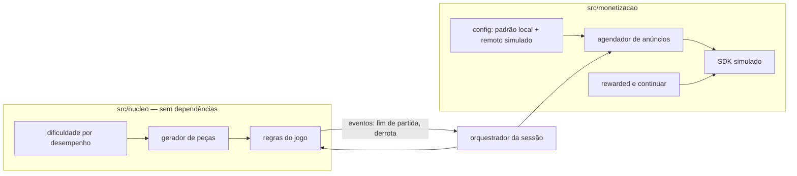

# Piloto: puzzle próprio com mecanismos plantados

Primeiro caso de ponta a ponta do ciclo de monetização: um puzzle pequeno, escrito por nós, com monetização simulada. Serve de **teste com resposta conhecida**: plantamos mecanismos, inclusive proibidos, numa variante separada e medimos se o `protocolo-monetizacao` os encontra, se o teste de invariância pega acoplamento entre anúncio e peças e se o Semgrep pega o acoplamento no código. Só depois disso o processo vai para um alvo de terceiros.

## 1. Perguntas que o piloto responde

| # | Pergunta | Como se mede |
|---|---|---|
| H1 | O protocolo encontra os mecanismos plantados, com o ID e os estados certos? | Análise cega da variante plantada × gabarito: acertos, erros de ID, estados errados, falsos positivos |
| H2 | O teste de invariância detecta quando a sequência de peças passa a depender do estado de anúncios (MON-0033)? | Passa no produto limpo; falha em cada mutação que planta o acoplamento |
| H3 | Regras Semgrep detectam o acoplamento no código antes de rodar? | `semgrep --test` com casos positivos e negativos; zero alertas no produto limpo; alerta em cada mutação |
| H4 | O perfil `monetizacao.json` com aprovação presa ao hash funciona num projeto real? | Checagem passa com o perfil aprovado e bloqueia depois de qualquer mudança de parâmetro |

Fora do escopo: SDK de anúncio real, rede, publicação em loja, usuários reais, experimento A/B, interface gráfica (fica como fase opcional).

## 2. O jogo

Puzzle de encaixe numa grade 8×8, gênero comum (parente de Tetris e dos jogos de blocos): o jogador recebe 3 peças por rodada, encaixa cada uma onde couber, linhas e colunas completas somem e pontuam; acaba quando nenhuma das peças cabe. Peças, nomes, regras de pontuação e textos são nossos; nada é tirado de jogo existente.

- **Núcleo puro e determinístico:** estado do jogo como dado, funções `novaPartida(semente)`, `jogadasPossiveis(estado)`, `jogar(estado, jogada)`. Sem relógio, sem aleatoriedade fora do gerador.
- **Gerador de peças próprio:** PRNG com semente (implementação curta e documentada, ex.: xoshiro128**), sorteio ponderado sobre o conjunto de peças.
- **Dificuldade dinâmica (MON-0004):** os pesos do sorteio podem mudar **só** com base no desempenho (ocupação da grade, derrotas seguidas). O contrato da função declara essas entradas e nenhuma outra.
- **Simulação headless:** jogador automático (estratégia gulosa simples) para rodar milhares de partidas nos testes.

## 3. Arquitetura

Regra de dependência: `src/nucleo/` **não importa nada** de `src/monetizacao/` nem do orquestrador. A monetização só reage a eventos do jogo (fim de partida, derrota) e nunca escreve no estado do núcleo, exceto pela ação explícita "continuar" (MON-0009), que tem contrato próprio e teste.

## 4. Mecanismos do produto limpo

O produto fica em `reimplementacoes/puzzle-piloto/`, com `monetizacao.json`, marcadores `// MON-NNNN` e a checagem do projeto valendo.

| ID | Mecanismo no piloto | Parâmetros iniciais (com unidade) |
|---|---|---|
| MON-0002 | Intersticial só no fim de partida, com intervalo mínimo e teto por sessão | `partidas_entre_anuncios: 2`, `intervalo_minimo_s: 60`, `max_por_sessao: 5`, `carencia_partidas: 2` |
| MON-0001 | Rewarded opcional: trocar as 3 peças da rodada | `max_por_partida: 1` |
| MON-0009 | Continuar após derrota com anúncio, uma vez, recusa com o mesmo destaque, sem contagem regressiva | `continuacoes_por_partida: 1` |
| MON-0003 | Compra simulada que remove intersticiais | — |
| MON-0004 | Dificuldade por desempenho | entradas: ocupação da grade, derrotas seguidas |
| MON-0011 (B, opcional) | Vidas com recarga por tempo, para exercitar a aprovação presa ao hash | `vidas_max: 5`, `recarga_min: 20` |

O SDK simulado expõe a mesma forma de um SDK real (carregar, exibir, callback de recompensa, falha), sem rede. A configuração "remota" vem de um arquivo local que o teste troca, para exercitar o estado de configuração (padrão local × valor efetivo).

`publico: geral`, `children_likely: "unknown"` (puzzle casual tem acesso provável por menores). Com isso, MON-0011 só entra se for `Infantojuvenil: permitido` (é) e com aprovação do responsável.

## 5. Teste de invariância (H2)

**Propriedade:** para a mesma semente e a mesma sequência de jogadas, a sequência de peças é idêntica qualquer que seja o estado de monetização.

- Gerar N sementes (ex.: 500) e, para cada uma, jogar com o jogador automático sob vários perfis de monetização: sem anúncios (compra MON-0003), intervalo 0 s, intervalo 60 s, intervalo 600 s, SDK sempre falhando, rewarded sempre aceito, rewarded sempre recusado, configuração remota trocada no meio da sessão.
- Comparar a sequência de peças e de pesos do sorteio entre perfis: precisa ser igual elemento a elemento até o ponto em que as jogadas divergem por decisão do jogador (ex.: continuar ou não). Onde as jogadas divergem, comparar a partir do mesmo estado do núcleo.
- Cenários de falha (da revisão de 20/10): anúncio indisponível, anúncio interrompido, callback de recompensa duplicado, relógio mudando, configuração remota inválida, perda de conexão simulada. Conferir que limites e entrega de recompensa continuam certos e que a sequência de peças não muda.
- **Teste do teste (mutação):** um conjunto de mutações plantadas no gerador ou na dificuldade (ler contador de anúncios, ler "anúncio pendente", ler "comprou remover anúncios", ler tempo desde o último anúncio). O teste de invariância precisa **falhar** em cada uma. Mutações vivem só no teste (aplicadas em memória), nunca no código do produto.
- Roda no `npm test` do projeto (`node:test`, sem dependências).

## 6. Regras Semgrep (H3)

Regras em `reimplementacoes/puzzle-piloto/semgrep/`, cada uma com arquivo de teste anotado (`// ruleid:` e `// ok:`) para `semgrep --test`.

| Regra | Pega | Severidade |
|---|---|---|
| R1 `nucleo-importa-monetizacao` | Qualquer `import` em `src/nucleo/**` de módulo de monetização, anúncio, oferta, loja ou orquestrador | erro |
| R2 `gerador-le-estado-de-monetizacao` | Gerador ou dificuldade acessando identificadores de anúncio, oferta, gasto ou compra (nomes, propriedades, parâmetros) | erro |
| R3 `fechar-abre-loja` | Handler de fechar/recusar que chama abrir loja, exibir anúncio ou comprar | erro |
| R4 `anuncio-fora-de-pausa` | Exibição de intersticial dentro de handler de jogada (colocar peça, arrastar) em vez de fim de partida | erro |
| R5 `recompensa-condicional` | Callback de recompensa com condição extra antes de entregar (MON-0030) | aviso |

- Zero alertas no produto limpo; alerta em cada mutação correspondente (as mesmas do teste de invariância, mais mutações de UI/fluxo para R3–R5).
- **Limite:** Semgrep vê padrões sintáticos e nomes. Renomear variáveis escapa de R2; por isso R1 (dependência entre pastas) e o teste de invariância (comportamento) são as garantias principais. Semgrep é a primeira barreira, não a única.
- **Instalação (ferramenta nova, segue a regra do projeto):** auditoria antes, versão fixada, registro em `docs/`. Preferência: imagem Docker oficial fixada por digest (isola do Python do sistema; Docker está instalado). Alternativa: `pip install semgrep==<versão>` num venv próprio em `ferramentas/semgrep/`. Suporte nativo a Windows precisa ser confirmado na auditoria. Se nenhuma das duas servir, R1 vira um script Node de grafo de importação (sem dependência) e R2–R5 ficam para depois.

## 7. Variante plantada e análise cega (H1)

- **Onde:** fontes da variante em `pilotos/puzzle-plantado/` (fora de `reimplementacoes/`, não é produto), gerada a partir do produto limpo com módulos substitutos. Build em `alvos/puzzle-plantado/` (fora do git), como qualquer alvo.
- **O que se planta:** de 4 a 6 mecanismos escolhidos na fase 5, misturando classes A, B e C, mais **iscas** (coisas que parecem suspeitas e não são, ex.: chave de configuração de anúncio que não é usada, dificuldade que lê só desempenho). A lista exata fica **só** em `pilotos/puzzle-plantado/GABARITO.md`, com o ID e os quatro estados esperados de cada item.
- **Segurança:** `registros/puzzle-plantado/00-seguranca.md` pelo protocolo normal (código nosso, triagem rápida), níveis N0 e N1 (análise estática do bundle JS com o REA). Execução (N3) só se o responsável aprovar, para testar o estado "execução".
- **Cegueira:** a análise roda numa **sessão nova**, sem este histórico, instruída a ler só a skill `protocolo-monetizacao`, o catálogo, o modelo 05 e `alvos/puzzle-plantado/`. Proibido ler `pilotos/`, `docs/plano-piloto-puzzle.md`, `reimplementacoes/puzzle-piloto/` e o histórico do git desses caminhos. Limite: a instrução não é imposta por gate; se for preciso imposição, acrescentar regra `deny` de leitura nessas pastas nas permissões da sessão de análise.
- **Controle de falso positivo:** a mesma sessão analisa também o build do produto limpo (`alvos/puzzle-limpo/`), sem saber qual é qual.
- **Comparação:** depois de os dois `05-monetizacao.md` estarem prontos, comparar com o gabarito numa tabela: encontrado com ID certo / ID errado / não encontrado / falso positivo, e estado por estado. Resultado e lições em `registros/puzzle-plantado/01-analise.md`; ajustes no protocolo ou no catálogo só com aprovação.

## 8. Fases

| Fase | Entrega | Critério de conclusão |
|---|---|---|
| F0 — Decisões | Stack, interface, instalação do Semgrep e inclusão de MON-0011 decididas (seção 10) | Respostas registradas neste plano |
| F1 — Núcleo | Grade, peças, regras, PRNG, dificuldade por desempenho, jogador automático; `ESPECIFICACAO.md` do jogo | Testes das regras e determinismo (mesma semente → mesma partida) passando |
| F2 — Monetização simulada | SDK simulado, agendador, rewarded, continuar, remover anúncios, configuração local/remota; `monetizacao.json` e marcadores | Checagem do projeto passa; testes de limites (intervalo, teto, carência, uma continuação) passando |
| F3 — Invariância | Teste da seção 5, cenários de falha e mutações | Passa no limpo; cada mutação faz o teste falhar |
| F4 — Semgrep | Auditoria e fixação, regras R1–R5 com testes, script `npm run semgrep` | `semgrep --test` passa; zero alertas no limpo; alerta em cada mutação |
| F5 — Variante plantada | `pilotos/puzzle-plantado/`, `GABARITO.md`, builds em `alvos/`, protocolo de segurança dos dois alvos | Builds reproduzíveis; hashes registrados |
| F6 — Análise cega | Dois `05-monetizacao.md` feitos em sessão separada; comparação com o gabarito | Tabela de acertos e erros; lições registradas; propostas de ajuste listadas para aprovação |
| F7 (opcional) — Interface | UI mínima em HTML/canvas para testar padrões visuais (botão de fechar, destaque da recusa) | Só se F6 mostrar que padrões de UI precisam de piloto próprio |

Cada fase termina com commit local. Push só pelo @devops com autorização.

## 9. Riscos e limites

- **Viés do analista:** o mesmo modelo que planta pode reconhecer o próprio estilo. Mitigação: sessão nova, leitura restrita, iscas e controle limpo. O resultado mede o protocolo nessas condições, não a eficácia contra alvo comercial.
- **Alvo fácil:** bundle JS pequeno, sem ofuscação, sem código nativo. Um alvo real terá IL2CPP, ofuscação e configuração remota de verdade. O piloto valida o método, não a escala.
- **Código C no repositório público:** a variante plantada contém mecanismos proibidos de propósito, como fixture de teste. Fica fora de `reimplementacoes/`, marcada como tal no README da pasta, e nunca vira produto.
- **Semgrep no Windows:** suporte a confirmar; há alternativa por script para R1.

## 10. Decisões para o responsável (F0)

**Decidido em 2026-10-20:** todas as recomendações abaixo foram aprovadas pelo responsável (JavaScript ESM sem dependências, headless, Semgrep via Docker após auditoria, incluir MON-0011, variante plantada em `pilotos/`).

| Decisão | Recomendação | Alternativa |
|---|---|---|
| Stack do puzzle | JavaScript ESM puro + `node:test`, sem dependências (o REA já analisa bundles JS; mesmo ferramental dos testes do projeto) | C# como o notepad (mais perto de Unity, mas a análise vira .NET) |
| Interface | Headless primeiro (F1–F6); UI só se F6 pedir | UI mínima desde o início |
| Semgrep | Docker fixado por digest, após auditoria | venv com `pip` fixado; ou só script de dependências |
| MON-0011 (classe B) | Incluir, para exercitar a aprovação presa ao hash | Deixar só classe A |
| Variante plantada no git | Sim, em `pilotos/` com aviso (o gabarito precisa ser versionado) | Fora do git, como alvo |
