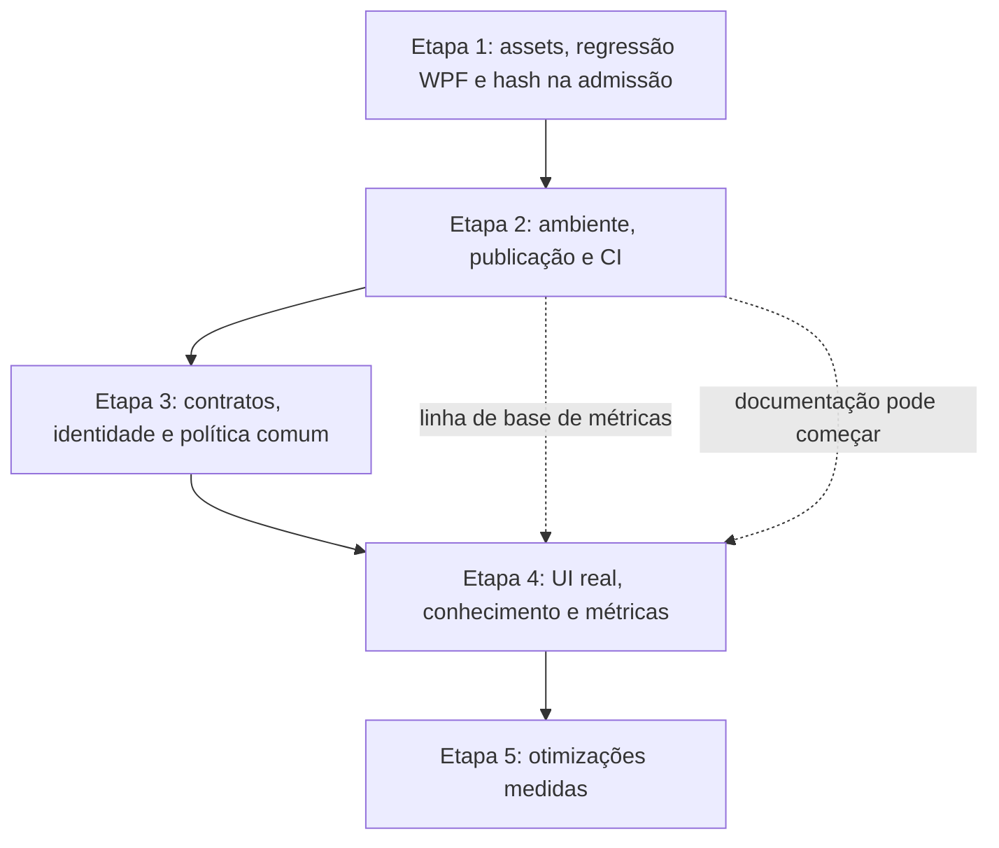

# Planejamento de evolução — arquitetura, eficiência e qualidade do PRKing_REA

**Data:** 01/11/2026 · **Status:** em execução — etapa 1 concluída; primeira rodada (§12) fechada em 01/11/2026; etapa 2 com stories em Draft.

**Base:** [análise de arquitetura e CTO](../analises/2026-11-01-arquitetura-cto-comparativo.md), sobre o checkout `0146a9494eae87d4637edba0b62482068730c62f` e o estado de trabalho observado naquela revisão.

**Revisão 1 (01/11/2026):** conferência contra o código no commit `7626b03`. Mudanças: MEL-02 tratada como regressão sem mudança de código; nova MEL-06a (hash na admissão) antecipada para a etapa 1; coordenação com o plano de perfil do alvo e com a medição do Harness; decisão sobre clientes suportados antes da MEL-07; auditoria de cada ferramenta nova; caminho curto de story para entregas P.

**Complemento à revisão 1:** histórico NB5 e ausência de mudança versionada confirmados. Refinamentos: hipóteses de build/ambiente continuam a exigir demonstração; escopo da admissão distingue binário de saída derivada e bundle; medições reaproveitam o Harness sem presumir cobertura de outros clientes; MEL-07 condicional não bloqueia entregas que não precisem de adapters adicionais (a condição foi resolvida pela decisão abaixo).

**Decisão do responsável (01/11/2026):** clientes suportados são Claude Code e Codex. A MEL-07 deixa de ser condicional e permanece como entrega G na etapa 3. Até ela ser entregue, o Codex não é usado com alvos. Como a medição do Harness não cobre outro cliente, a MEL-11 precisa de uma fonte própria para as sessões do Codex ou as marca como indisponíveis.

## 1. Direção recomendada

Evoluir o laboratório para que cada investigação seja identificável, repetível e verificável: saber qual arquivo foi analisado, com qual autorização, por qual ferramenta, com quais resultados e quais limitações. A eficiência vem de reaproveitar evidências válidas e conhecimento, reduzindo buscas e chamadas repetidas.

Isso reforça os objetivos já existentes: análise de software, documentação de comportamento, identificação de mecânicas e monetização, especificação em sala limpa e validação do próprio método. A arquitetura atual continua como base.

As sugestões abaixo têm três níveis de certeza:

- **Correção fundamentada:** resolve comportamento ou lacuna constatados na revisão.
- **Prevenção arquitetural:** reduz uma possibilidade de erro demonstrada pela estrutura, sem afirmar que houve incidente.
- **Experimento:** só será adotado se medições confirmarem benefício.

O planejamento autoriza a preparação do trabalho; não representa aprovação de novos níveis de análise, alteração de perfis de monetização, atualização de ferramentas ou publicação. As regras existentes continuam válidas em cada execução.

## 2. Situação de partida e resultado desejado

Os números são a linha de base da análise anterior, não uma nova execução de testes nesta entrega.

| Aspecto | Situação observada | Resultado desejado |
|---|---|---|
| Testes JavaScript | 164 aprovados | Preservar cenários existentes e acrescentar regressões dos novos comportamentos |
| Núcleo .NET | 137 aprovados | Preservar conformidade, codificação e integridade de gravação |
| Interface WPF | 72 aprovados; quatro falhas repetidas isoladamente. Em 22/10 o mesmo código passou 76/76 duas vezes (story NB5) | Causa da regressão identificada e conjunto relevante estável em ambiente documentado |
| Assets inválidos | WAV truncado pode encerrar o lote sem catálogo | Falha individual registrada; catálogo gerado; conclusão global informa falhas |
| Verificação completa | Comandos separados; sem workflows versionados | Um resultado agregado informa o que passou, falhou ou não foi executado |
| Autorização | Hooks de um cliente e ponteiro global de alvo; hash registrado não é conferido | Hash conferido na admissão; entradas suportadas usam política comum e contexto de execução explícito |
| Evidências | Boa disciplina documental; identidade não imposta em todas as chamadas | Evidência vinculada ao alvo, execução, ferramenta e revisão de autorização |
| Conhecimento | Distribuído em documentos, registros e referências | Índice gerado permite localizar informação com fonte, versão e validade |
| Eficiência | Sem medição consolidada de tempo/custo por pergunta | Melhorias comparadas com linha de base e correção dos resultados |

## 3. Sequência de entrega e dependências

As setas representam dependências para encerrar a etapa. Documentação e coleta de métricas podem começar antes. A CI também pode ser preparada enquanto as falhas conhecidas são investigadas; seu resultado deve continuar mostrando essas falhas, sem ocultá-las.

MEL-06a e o desenho de identidade/concorrência não esperam a conclusão da CI. Até comprovar isolamento por execução, o mesmo checkout e a mesma instância do provider devem ser usados de forma serial para os alvos; sessões próprias continuam compartilhando `ALVO_ATIVO`. Trata-se de mitigação operacional proposta, não de prova de incidente já ocorrido.

| Etapa | Entregas | Por que nessa ordem | Condição para encerrar |
|---|---|---|---|
| 1. Estabilidade | MEL-01, MEL-02 e MEL-06a | Resolve falhas conhecidas e evita construir automação sobre um resultado incompleto. A MEL-06a fecha a parte barata de um achado P1 (A03) sem esperar os contratos | Regressões demonstradas e correções verificadas |
| 2. Repetibilidade | MEL-03, MEL-04 e MEL-08 | Torna a qualidade verificável fora da máquina atual antes das mudanças maiores | Clone limpo consegue executar verificações; CI publica resultado agregado fiel |
| 3. Controle da investigação | MEL-05, MEL-06 e MEL-07 | Contratos claros precedem identidade por execução, que precede a expansão para o Codex (clientes suportados: Claude Code e Codex, decisão de 01/11/2026) | Testes recusam identidades divergentes e todas as entradas declaradas suportadas aplicam a política |
| 4. Qualidade de uso e conhecimento | MEL-09, MEL-10 e MEL-11 | Valida a interface real e organiza o que será reutilizado e medido | Fluxos críticos testados, índice rastreável e linha de base registrada |
| 5. Eficiência e expansão seletiva | MEL-12, MEL-13 e MEL-14 | Desempenho e troca de ferramenta dependem de evidência de ganho | Cada otimização adotada passa pelo seu critério; experimento sem ganho é encerrado |

### Coordenação com outros planos e medições existentes

- **Plano de perfil do alvo e pacote de recursos** ([2026-11-01-perfis-alvo.md](2026-11-01-perfis-alvo.md), handoff [2026-11-01-perfis-alvo-fase-0.md](../handoffs/2026-11-01-perfis-alvo-fase-0.md)). Corre em paralelo e já registra um ponto de coordenação com este plano. Sobreposições: a U5 de lá propõe uma família de tool no `rea-niveis.json`, o mesmo arquivo que entra no contrato da MEL-05; o perfil do alvo pode compor a chave de cache da MEL-12; a U4 de lá mede custo por sessão com as mesmas fontes que a MEL-11 deve usar. Regra: nenhum dos dois planos altera `rea-niveis.json`, `00-seguranca.md` ou o gate sem conferir o estado do outro; quem chegar primeiro registra a mudança e o outro adapta.
- **Medição do Harness.** Já existem `~/.claude/skills/skill-budget/scripts/sessao.js` (custo e contexto por sessão), `H:\King\Harness\ferramentas\uso.js` (uso de tools) e medições em `H:\King\Harness\docs\medicoes\`. A MEL-11 parte dessas fontes e só cria instrumentação nova para o que elas não cobrem (identidade da execução, pergunta e critério de resolução, acerto).

### Capacidade e estimativas

Usar lotes pequenos, com uma story por entrega e responsáveis distintos por execução e revisão quando houver disponibilidade. Os papéis AIOX indicados são responsabilidades propostas, não agentes já designados.

Tamanhos relativos: **P** = alteração localizada; **M** = vários arquivos e integração limitada; **G** = decisão de arquitetura, migração e integração entre componentes. São estimativas preliminares de complexidade, não dias, orçamento ou compromisso de prazo.

O processo acompanha o tamanho: entregas **P** seguem o caminho curto do SDC (story enxuta, implementação e QA na mesma unidade, como prevê o guia de workflows para correções simples); entregas **M** e **G** seguem o ciclo completo (@sm → @po → @dev → @qa). O laboratório tem um único responsável, e o ciclo completo em toda entrega consumiria mais revisão que implementação.

A primeira rodada de planejamento cobre somente a etapa 1 e a preparação da etapa 2. Ao encerrá-la, usar o tempo real gasto e a disponibilidade do responsável para estabelecer o calendário das demais. O trabalho de identidade/política deve ser dividido em slices se não couber em uma story revisável.

#### Capacidade observada na primeira rodada (revisão de 01/11/2026)

Fontes: handoffs [MEL-01/MEL-02](../handoffs/2026-11-01-evolucao-etapa1-mel01-mel02.md) e [MEL-06a](../handoffs/2026-11-01-evolucao-etapa1-mel06a.md), `sessao.js` e o transcript de cada sessão (duração = primeiro ao último evento). Só Claude Code; o Codex não foi usado nem medido.

| Sessão | Entregas | Tamanho | Duração | Chamadas | Contexto médio / máx. | Requisições > 200k | Retrabalho |
|---|---|---|---|---|---|---|---|
| `ed91c88e` | MEL-01 e MEL-02 | P + P | 57 min | 72 | 191k / 250k | 47% | 1 commit refeito (arquivamento no índice errado) |
| `07ad7cae` | MEL-06a | P | 10 min | 42 | 166k / 219k | 21% | 2 ajustes de script |
| `b0f09ab6` | preparação da etapa 2 (MEL-03 fatia 1, desenho MEL-08, linha de base, stories) | M parcial + docs | ver [handoff](../handoffs/2026-11-01-evolucao-etapa2-preparacao.md) | ~50 até aqui | 177k / 230k | 28% | 2 ajustes de mensagem do verificador |

Leitura:

- Cada entrega P coube numa sessão, com Fase 0, story, QA curto e handoff. Duas P juntas também couberam, mas com quase metade das requisições acima de 200k: o limite preliminar de ~180k (D9) foi ultrapassado nas três sessões. Para M, uma story por sessão.
- O custo fixo de uma sessão (instruções, Fase 0, leitura do plano de 520 linhas) fica em ~95k antes do trabalho. Ler o plano inteiro em toda sessão pesa; as próximas leem só a seção da MEL e a story.
- O gargalo da etapa 2 não é execução, é decisão do responsável: ligar o Docker para a linha de base do Semgrep, auditorias de ferramenta nova (lint, tipos, detector de segredos, actions), ativação da CI e proteção de branch.

Unidades propostas para a etapa 2 (uma sessão cada; calendário fica com a disponibilidade do responsável):

| # | Unidade | Story | Depende de |
|---|---|---|---|
| 1 | Validação @po das três stories | MEL-03, MEL-04, MEL-08 | — |
| 2 | MEL-03 fatia 2: auditoria e escolha de lint e tipos | [MEL-03](../stories/mel-03-ambiente-verificacao.story.md) | 1; aprovação da ferramenta |
| 3 | MEL-04: módulo de publicação compartilhado | [MEL-04](../stories/mel-04-publicacao-compartilhada.story.md) | 1; decisão sobre detector externo |
| 4 | MEL-08 local: sonda WPF, agregador, auditoria das actions | [MEL-08](../stories/mel-08-ci-agregada.story.md) | 1 |
| 5 | MEL-08 ativação: workflow, PRs de falha plantada, proteção de branch | MEL-08 | 3, 4; aprovação do responsável; push pelo @devops |

## 4. Etapa 1 — corrigir falhas e estabelecer confiança

### MEL-01 — tornar a organização de assets resistente a arquivos inválidos

**Origem:** A05 · **Tipo:** correção fundamentada · **Tamanho:** P · **Responsáveis sugeridos:** @dev, revisão @qa.

**Problema e justificativa:** um arquivo RIFF/WAVE de 12 bytes provocou `ERR_OUT_OF_RANGE` antes da escrita do catálogo. Um único arquivo defeituoso compromete a visibilidade do lote inteiro, situação relevante em engenharia reversa, que frequentemente lida com arquivos desconhecidos ou incompletos.

**Trabalho proposto:** validar comprimentos antes de ler campos e validar limites dos chunks. Tratar erros de identificação, leitura, hash e cópia por item. Continuar os itens independentes, registrar o motivo e salvar o catálogo ao final. Distinguir erro por item de erro fatal de configuração: origem inacessível ou destino inválido não deve parecer um lote vazio bem-sucedido.

**Melhoria esperada:** menos reinício de trabalho; inventário útil mesmo em caso de falha parcial; diagnóstico preciso de quais arquivos precisam de tratamento adicional.

**Aceite:**

- [x] WAV truncado entra no catálogo com estado de erro, sem derrubar os demais arquivos válidos.
- [x] Lote com falha parcial salva JSON/CSV/resumo e devolve exit code não zero.
- [x] Arquivos válidos mantêm classificação, hash, deduplicação e proteção contra sobrescrita.
- [x] Mensagens, estados e regressão entram no guia do organizador e em seus testes.

**Entregue em 01/11/2026:** [story MEL-01](../stories/mel-01-assets-resilientes.story.md), commit `f594953`.

**Superfície prevista:** `scripts/assets/organizar-assets.mjs` e seu teste; documentação aplicável. Concorrência e retomada ficam para MEL-12, depois da correção.

### MEL-02 — diagnosticar e resolver a regressão das quatro falhas de interface WPF

**Origem:** A04, com evidências da seção 5 do relatório · **Tipo:** correção fundamentada · **Tamanho:** P se a causa for de ambiente ou build; reclassificar para M se exigir mudança no produto ou no harness · **Responsáveis sugeridos:** @dev + @qa.

**Problema e justificativa:** os quatro cenários falham na habilitação de Recortar/Copiar/Excluir, Desfazer e Colar. Na abertura de arquivo, a asserção de que o editor não tem desfazer passa; a divergência está no menu.

O fato decisivo: **o mesmo código já passou.** A story NB5 registra `dotnet test PRKingNotepad.slnx` verde duas vezes seguidas em 22/10, com UI 76/76. O último commit em `reimplementacoes/notepad/` é o `50770d5` (só documentação), posterior aos auxiliares de teste do `9fb0281`. Código igual com resultado diferente aponta primeiro para o build testado ou para o ambiente, não para um defeito novo do produto. Mexer no produto antes de descartar essas causas pode introduzir uma mudança desnecessária.

Na conferência em `7626b03`, `git diff 50770d5 HEAD -- reimplementacoes/notepad` ficou vazio. Isso muda a ordem do diagnóstico, mas não prova uma causa única nem exclui defeito latente sensível ao ambiente. Não apresentar falha da suíte como defeito novo do produto sem essa distinção.

**Trabalho proposto, em ordem:**

1. **Build testado.** O QA verde usou `--artifacts-path` fora do repositório, porque o executável do responsável travava `bin/`; a revisão rodou no caminho padrão com `--no-restore` e, na reexecução, `--no-build`. Rodar build limpo (`--no-incremental`) no caminho usado pelo QA e no padrão, e registrar qual binário cada execução testou.
2. **Ambiente.** Registrar e comparar com 22/10 o que for recuperável: SDK e runtime do .NET (a análise informou SDK selecionado `10.0.401`, mas não inventariou todos os SDKs/runtimes instalados; não há `global.json`), atualizações do Windows no período, histórico e sincronização do clipboard (o teste de Colar falha com imagem no clipboard), foco e sessão do desktop, outro PRKing Notepad aberto. Preservar o clipboard do responsável e não alterar configurações globais por tentativa.
3. **Produto ou harness**, só se 1 e 2 não explicarem: verificar reconsulta do estado dos comandos, foco e abertura dos menus no helper `Notepad.IsEnabled`; confrontar com observação da aplicação própria em cenário controlado.

Corrigir conforme a causa comprovada. Não alterar a especificação para acomodar uma falha de teste. Se a causa for ambiente, a correção pode ser fixar o SDK (MEL-03) ou isolar o estado global que o teste usa, e o achado alimenta a categoria de testes dependentes de ambiente da MEL-08.

**Melhoria esperada:** restaura confiança na suíte e no estado dos comandos; evita confundir limitação da automação ou mudança de máquina com defeito de edição.

**Aceite:**

- [x] Causa de cada falha documentada, classificada como build, ambiente, harness ou produto, com a evidência que descartou as anteriores.
- [x] Os quatro cenários e a suíte WPF passam em duas execuções consecutivas, a partir de build limpo, sem alterações intermediárias.
- [x] Estabilidade obtida por condição observável do dispatcher/controle ou por isolamento do estado global, sem sleeps arbitrários ou remoção de asserções.
- [x] Dependências de estado do sistema (clipboard, foco, sessão interativa) que restarem ficam listadas para a MEL-08.
- [x] Testes do Core e conformidade de abertura/gravação continuam verdes.

**Entregue em 01/11/2026:** [story MEL-02](../stories/mel-02-regressao-wpf.story.md). Causa: ambiente (a suíte do parecer rodou no sandbox elevado do Codex, usuário `CodexSandboxOffline`); sem mudança no Notepad; pendências listadas para a MEL-08.

**Superfície prevista:** diagnóstico sem alteração de arquivos nos passos 1 e 2; implementação e testes em `reimplementacoes/notepad/` só no passo 3. Nova story de regressão, preservando o histórico de QA da story NB5 já concluída. A sessão de implementação lê somente código próprio e especificação permitida.

### MEL-06a — conferir o hash do alvo na admissão

**Origem:** A03 (P1) · **Tipo:** correção fundamentada · **Tamanho:** P · **Responsáveis sugeridos:** @dev, revisão @qa.

**Problema e justificativa:** o gate lê `status`, níveis e caminhos do `00-seguranca.md`, mas não confere o SHA-256 registrado; a reprodução da análise com conteúdo substituído retornou `allow`. A parte ampla do problema (identidade por execução, provider, concorrência) fica na MEL-06, que depende de contratos. A conferência do hash no momento em que o alvo entra na ferramenta é localizada e não precisa esperar.

O risco é atual: o projeto roda cada alvo cego numa sessão própria, e todas leem o mesmo `registros/ALVO_ATIVO`.

**Trabalho proposto:** nas tools que admitem conteúdo (abertura de binário, importação, extração, inspeção de artefato), calcular o SHA-256 do caminho pedido e comparar com o registrado no `00-seguranca.md` do alvo ativo; divergência ou hash ausente bloqueia, fail-closed, com mensagem que aponta o protocolo. Calcular só na admissão, não a cada consulta, para não recalcular arquivos grandes. A lista de tools de admissão vem do `rea-niveis.json` e do `ghidra-niveis.json` existentes, sem mudar níveis.

**Delimitação:** conferir os schemas da versão fixada para identificar os pontos reais de admissão; os mapas de níveis sozinhos não descrevem todos os argumentos. Relacionar cada arquivo original ao seu hash aprovado, inclusive quando houver vários arquivos. Saída extraída/derivada recebe proveniência própria e não deve ser comparada ao hash do arquivo pai. Bundle de evidência exige seu contrato de identidade, não comparação entre hash do bundle e hash do binário. Hash ausente ou ambíguo não autoriza preencher aprovações automaticamente. A entrega só promete cobertura dos pontos testados; confirmar P após verificar esses formatos, fatiando eventual migração à parte.

**Melhoria esperada:** uma aprovação deixa de valer para outro conteúdo no mesmo caminho.

**Aceite:**

- [x] Arquivo substituído após a aprovação é bloqueado na admissão; o original continua liberado.
- [x] Alvo sem hash registrado é bloqueado com motivo claro, sem editar `status` nem `niveis_aprovados`.
- [x] Regressões novas em `rea-gate.test.mjs`; `npm test` verde.
- [x] Limitação documentada: substituição depois da admissão e troca de programa no Ghidra continuam cobertas só pela MEL-06.

Feito em 01/11, ver [story MEL-06a](../stories/mel-06a-hash-admissao.story.md): o hash vem da nova seção 8 "Identidade dos arquivos" do `00-seguranca.md`; todo argumento de caminho para `alvos/<slug>/` é admissão (arquivo ou cada arquivo de um diretório); `saidas/<slug>/` não é comparado; 5 regressões, `npm test` 173/173. A migração dos registros existentes, que ficam bloqueados na admissão até lá, é a fatia MEL-06a-m, alvo por alvo, com aprovação do responsável. O CLI (`cli-gate.mjs`) não confere hash: fica na MEL-07.

**Dependências:** nenhuma. A MEL-06 parte desta conferência em vez de reimplementá-la. Mudança em `.claude/hooks/` exige `npm test`, conforme o CLAUDE.md.

## 5. Etapa 2 — qualidade reproduzível em qualquer clone suportado

### MEL-03 — declarar ambiente e criar um contrato de verificação local

**Origem:** A07 e parte de A04 · **Tipo:** correção fundamentada · **Tamanho:** M · **Responsáveis sugeridos:** @dev, @devops e @qa.

**Problema e justificativa:** versões documentadas e lockfiles ajudam, mas não garantem que outro clone use os mesmos runtimes. O comando principal cobre apenas parte da base, e os scripts de lint e typecheck citados nas instruções genéricas não existem.

**Trabalho proposto:** declarar versões suportadas de Node e .NET em arquivos apropriados ao projeto; conferir compatibilidade com o REA fixado; usar instalação npm que respeite o lockfile e `--ignore-scripts`; usar restore .NET em modo travado na validação. Inventariar Ghidra, Java, Python/uv e imagem Semgrep efetivamente usados. Expor verificações por componente e um agregador que preserve a falha de qualquer etapa obrigatória.

Para JavaScript ESM, introduzir lint de forma incremental e avaliar checagem de tipos com JSDoc/`checkJs` nos módulos de política e scripts mais críticos. A ferramenta e seu escopo serão definidos na story após verificar compatibilidade e custo. Um comando chamado `typecheck` só será declarado se realmente analisar tipos; `node --check` deve continuar identificado como sintaxe.

O `global.json` do .NET tem prioridade: a falta dele é uma das hipóteses da regressão da MEL-02. Toda ferramenta nova desta entrega (linter, verificador de tipos) passa pela mesma regra das demais: auditoria registrada em `docs/seguranca/`, versão fixada, instalação com `--ignore-scripts`.

**Melhoria esperada:** menos diferenças entre máquinas, diagnóstico previsível e um resultado de qualidade compreensível por pessoas e agentes.

**Aceite:**

- [ ] Guia de clone limpo informa versões, instalação, comandos e requisitos por componente.
- [ ] Mudança não aprovada de dependências faz a validação travada falhar.
- [ ] Agregador distingue aprovado, falhou e não executado; requisito ausente nunca é convertido em sucesso.
- [ ] Lint e tipos têm escopo explícito, ou decisão de implantação em etapas com pendências visíveis.

**Dependências:** pode começar junto da etapa 1; encerramento integrado com MEL-08. A declaração do ambiente não atualiza o REA nem instala ferramentas automaticamente.

**Fatia 1 entregue em 01/11/2026** ([story MEL-03](../stories/mel-03-ambiente-verificacao.story.md), commit `5e71dbd`): `reimplementacoes/notepad/global.json` (SDK 10.0.401, `rollForward: patch`), `.node-version` (26.12.1), `engines`, `.npmrc`, `npm run verificar` e o [contrato de ambiente](../contrato-ambiente.md). Aceites 1–3 atendidos; o 4 (lint e tipos) está em etapas, com pendência visível. A story continua em Draft para a validação @po antes da fatia 2.

### MEL-04 — transformar a política de publicação em verificação compartilhada

**Origem:** A06 · **Tipo:** prevenção arquitetural · **Tamanho:** M · **Responsáveis sugeridos:** @dev + @qa; integração @devops.

**Problema e justificativa:** o pre-commit local é útil, mas não é executado em todos os meios de publicação. Extensão, tamanho e comprimento de blocos não identificam todos os segredos, dados brutos ou conteúdo do alvo.

**Trabalho proposto:** extrair a lógica de publicação para módulo reutilizável pelo hook e pela CI; verificar o conteúdo que entra no commit, incluindo adições, exclusões e renomes. Validar caminhos proibidos, binários e limites já adotados; incorporar detecção de segredos com exceções justificadas e testadas. Limitar relatórios a caminhos e tipos de ocorrência, sem imprimir o valor detectado.

O detector de segredos é ferramenta nova: antes de entrar, auditoria no mesmo método de `docs/seguranca/auditoria-semgrep-1.180.0.md`, versão fixada (digest ou hash) e execução sem rede e sem telemetria. Se nenhum candidato passar na auditoria, começar por regras próprias para os formatos de segredo realmente usados no projeto e registrar a lacuna.

**Melhoria esperada:** a regra passa a ser verificável em mais de um ponto, reduzindo dependência da configuração particular de cada clone.

**Aceite:**

- [ ] Mesmas fixtures produzem a mesma decisão no hook e na checagem de CI.
- [ ] Arquivo proibido adicionado à força, segredo sintético e bloco extenso são recusados.
- [ ] Casos permitidos, modelos, renomes e remoções não geram bloqueio indevido.
- [ ] A verificação não imprime segredos e não declara que revisão humana de origem ficou dispensada.

**Dependências:** contrato de execução de MEL-03; necessário para concluir MEL-08. A CI consegue detectar material que já chegou ao remoto; a prevenção antes do envio continua sendo local. Este trabalho não inclui varredura do histórico completo.

### MEL-08 — implantar CI por componente com resultado agregado

**Origem:** A04 · **Tipo:** correção fundamentada · **Tamanho:** M · **Responsáveis sugeridos:** @devops, critérios @qa.

**Problema e justificativa:** testes existentes não são repetidos automaticamente no GitHub por configuração versionada. Assim, uma mudança pode passar pelo fluxo JS e quebrar WPF ou as regras de detecção.

**Trabalho proposto:** jobs para JS e monetização; build/testes .NET em Windows; Semgrep com scan, testes das regras e mutações. Usar versões fixadas, permissões mínimas e fixtures próprias. Os jobs não recebem amostras de alvos, `saidas/`, credenciais de análise ou gabaritos de sessões cegas. O status final deve refletir cada job obrigatório e filtros de caminho devem ser testados para não ocultar verificações necessárias.

**Repositório público.** Em `ianbenicio/King_REA`, logs e artefatos de Actions são públicos. A restrição vale para a saída dos jobs, não só para os artefatos: nada de conteúdo de arquivos, variáveis de ambiente ou caminhos de `alvos/` e `saidas/` nos logs; relatórios de falha citam caminho e tipo de ocorrência.

**Testes dependentes de ambiente.** Os testes WPF de clipboard, foco e menu dependem de estado global e de sessão interativa, que um runner Windows hospedado pode não oferecer da mesma forma. Separá-los numa categoria própria (com o resultado da MEL-02), com status distinto de "falhou": "não executável neste runner" fica visível e nunca vira aprovado. Instabilidade do runner não pode ser lida como regressão do produto, nem o contrário.

Uma asserção que falha continua registrada como falha até existir evidência para atribuir a causa ao ambiente. Classificar como "não executável" exige detectar um pré-requisito ausente, não apenas reconhecer um teste de clipboard/foco. Se a categoria não puder rodar no runner hospedado, manter a pendência e obter evidência local reproduzível no ambiente suportado antes de declarar a validação WPF completa; runner próprio é uma opção a avaliar, não infraestrutura obrigatória deste plano.

**Melhoria esperada:** defeitos são vistos na revisão da mudança, com evidência repetível e menor esforço de conferência manual.

**Aceite:**

- [ ] Em execução normal, todos os componentes aplicáveis contribuem para o resultado final.
- [ ] Falha plantada em teste JS, .NET ou regra Semgrep torna o resultado agregado reprovado.
- [ ] Ambiente sem Docker ou falha do runner fica visível; não recebe status de aprovado.
- [ ] Publicação de logs e artefatos é restrita aos resultados sintéticos permitidos.
- [ ] Testes dependentes de ambiente aparecem como categoria própria; "não executável" nunca é contado como aprovado.

**Dependências:** MEL-03 e MEL-04; falhas conhecidas de MEL-02 continuam visíveis até serem corrigidas. Configuração pode ser preparada localmente; push e alterações de proteção remota seguem a autoridade de @devops e a autorização do responsável.

**Desenho pronto em 01/11/2026, sem ativação:** [desenho da CI](2026-11-01-desenho-ci-mel08.md) (commit `d90adb5`) e [story MEL-08](../stories/mel-08-ci-agregada.story.md). Cada job roda o verificador da MEL-03; WPF interativo e Semgrep no Windows hospedado ficam fora; Semgrep no Ubuntu hospedado depende de decisão do responsável.

## 6. Etapa 3 — autorização vinculada à investigação correta

### MEL-05 — definir contratos e inventário único de integrações

**Origem:** A08 · **Tipo:** prevenção arquitetural · **Tamanho:** M · **Responsáveis sugeridos:** @architect, implementação @dev, revisão @qa.

**Problema e justificativa:** mapa de níveis, matcher, configuração MCP e documentação podem divergir. O gate também lê campos de aprovação por regex, o que dificulta validar estrutura e revisões de forma consistente.

**Trabalho proposto:** registrar um contrato de servidor e ferramenta com identidade, versão, nível, tipo de recurso acessado e suporte a contexto de execução. Especificar schema para a parte estruturada do protocolo, mantendo a narrativa Markdown. Começar por um verificador de consistência entre os arquivos existentes; gerar configurações só onde simplificar a manutenção.

**Melhoria esperada:** servidor novo ou tool nova deixa de depender de lembrança de editar vários lugares; mensagens de erro explicam qual contrato está incompleto.

**Aceite:**

- [ ] Servidor configurado sem classificação/entrada protegida é apontado como integração incompleta.
- [ ] Tool desconhecida, schema inválido e nível sem autorização são recusados nos caminhos suportados.
- [ ] Validação diferencia arquivo legado, inválido e revisão nova; não aprova nem migra níveis automaticamente.
- [ ] Inventário e documentação indicam quais combinações de cliente/provider foram testadas.

**Dependências:** MEL-03 e MEL-08 como base de validação. As decisões serão documentadas em ADR proposto antes da alteração dos contratos. Coordenar com a U5 do plano de perfil do alvo, que propõe uma família de tool no mesmo `rea-niveis.json`: o contrato acomoda esse campo em vez de criar um segundo mecanismo (seção 3).

O piloto paralelo continua apenas orientativo: U1–U4 não autorizam filtro de tools ou mudança no gate. Compatibilidade de schema pode ser planejada aqui, mas aplicação da família no controle continua condicionada ao resultado da U4 e à aprovação prevista para U5. Desenho e validações locais de consistência podem preceder a CI completa.

### MEL-06 — criar identidade explícita e isolamento de contexto por execução

**Origem:** A02 e A03 · **Tipo:** prevenção arquitetural · **Tamanho:** G · **Responsáveis sugeridos:** @architect + @dev, revisão @qa.

**Problema e justificativa:** o diretório e o `ALVO_ATIVO` não comprovam que a ferramenta está usando a versão aprovada. Uma sessão aberta no Ghidra pode ainda apontar para outro programa. Concorrência amplia o risco de associar uma resposta ao contexto errado.

**Trabalho proposto:** criar manifesto de execução com `run_id`, alvo, manifesto/hash de arquivos, revisão do protocolo, níveis, versões, projeto/sessão do provider e diretórios de saída. Partir da conferência de hash na admissão já entregue pela MEL-06a e vinculá-la ao `run_id`. Para identidade forte durante a execução, usar uma cópia controlada e política documentada de imutabilidade/revalidação; caminho, tamanho e mtime sozinhos não provam conteúdo imutável.

Para Ghidra, verificar na versão fixada se existe identidade selecionável por chamada. Se o provider depender de um programa global, limitar a uma execução por instância e impedir troca durante operações; se isso não puder ser garantido, a combinação não será declarada segura para concorrência. Uma consulta de identidade antes da chamada, isoladamente, não elimina a corrida com troca posterior.

Adicionar exportação da especificação com origem e commit, acompanhada de lista permitida de arquivos para a sessão de implementação. A efetividade da sala limpa depende das permissões/montagens desse ambiente; não é obtida apenas com uma recomendação escrita.

**Melhoria esperada:** conclusões passam a ter contexto inequívoco; reduz troca acidental de alvo e facilita repetir uma investigação ou explicar divergências entre versões.

**Aceite:**

- [ ] Substituição do arquivo após a aprovação, programa divergente e revisão de protocolo divergente são detectados antes da operação protegida.
- [ ] Duas execuções não compartilham autorização, provider ou evidência por acidente.
- [ ] URL e dispositivo têm identidade própria; não são tratados artificialmente como arquivos locais.
- [ ] `ALVO_ATIVO` deixa de ser autoridade para o novo fluxo; compatibilidade legada permanece explícita e separada, sem fallback silencioso.
- [ ] Sessão de implementação recebe apenas os artefatos autorizados; teste de acesso negativo comprova a restrição onde houver suporte técnico.

**Dependências:** MEL-05 e MEL-06a. Dividir a entrega em identidade de arquivo, vínculo de provider e isolamento de sessão. Não acrescentar níveis nem revalidar aprovações humanas por conta própria.

### MEL-07 — aplicar uma política comum às entradas CLI e MCP suportadas

**Origem:** A01 · **Tipo:** prevenção arquitetural · **Tamanho:** G · **Responsáveis sugeridos:** @architect + @dev, integração @devops e revisão @qa · **Clientes suportados:** Claude Code e Codex (decisão do responsável, 01/11/2026; seção 10).

**Problema e justificativa:** hooks específicos de um cliente não protegem automaticamente outro cliente ou um caminho direto. Duplicar toda a lógica para Codex criaria versões diferentes da mesma política. Hoje o checkout não tem configuração nem adaptador versionado para o Codex; enquanto a MEL-07 não estiver entregue, o Codex não deve ser usado com alvos.

**Escopo dos clientes:** os adapters cobrem as entradas CLI e MCP do Claude Code e do Codex. Para o Codex, a story verifica na versão em uso como ele declara servidores MCP, se oferece interceptação antes da chamada e como pede confirmação ao usuário; essas respostas definem se o adapter é hook, wrapper ou proxy. Outros clientes e chamada direta ao provider seguem sem suporte, com o limite documentado.

**Trabalho proposto:** um módulo comum decide autorização e identidade; adapters de entrada recebem chamadas do CLI e MCP e traduzem seus contratos. Preferir wrapper simples primeiro; adotar proxy persistente somente se necessário ao transporte e à sessão. Garantir que a instância do provider seja criada/selecionada sob o contexto de MEL-06.

Preservar confirmação humana por operação quando exigida: um adapter sem mecanismo de confirmação compatível deve recusar aquela operação, nunca converter pedido de confirmação em autorização permanente. Hooks atuais podem continuar como defesa adicional.

**Melhoria esperada:** uma correção na política beneficia todas as entradas suportadas; fica mais fácil verificar e documentar o que cada cliente realmente garante.

**Aceite:**

- [ ] Mesma entrada lógica produz decisão equivalente no CLI e nos adapters MCP suportados.
- [ ] N3/N4b continuam exigindo confirmação individual; cliente sem suporte recusa com motivo claro.
- [ ] Falha do módulo de política, execução ausente ou identidade inválida bloqueiam a operação.
- [ ] Chamadas diretas ainda possíveis e limites das permissões do sistema operacional estão documentados.
- [ ] Nenhum uso direto é anunciado como protegido sem uma barreira técnica correspondente.

**Dependências:** MEL-05 e MEL-06. Wrapper melhora uniformidade, mas não cria uma sandbox: se a mesma identidade do sistema pode acessar o provider diretamente, o limite permanece. Um isolamento adicional de processo/usuário exige decisão arquitetural específica.

## 7. Etapa 4 — validar o uso real e reutilizar o conhecimento

### MEL-09 — acrescentar testes em navegador real aos fluxos críticos do puzzle

**Origem:** A09 · **Tipo:** prevenção arquitetural · **Tamanho:** M · **Responsáveis sugeridos:** @dev + @qa.

**Problema e justificativa:** o teste atual de interface exercita controle e servidor sem navegador. Isso protege a lógica, mas não observa foco, tamanho efetivo, sobreposição, DOM e comportamento em viewport diferente.

**Trabalho proposto:** poucos testes reais para iniciar/jogar/encerrar, recusar ofertas, fechar anúncios simulados, confirmar/cancelar compra e navegar por teclado. Verificar desktop e celular de referência; inspecionar nome acessível, alvo clicável e ausência de ação comercial disparada ao recusar. A escolha do runner de navegador depende de avaliação da compatibilidade e da decisão anterior de manter o piloto sem novas dependências. Se a escolha trouxer pacote novo, ele passa por auditoria e fixação de versão, como as demais ferramentas; preferir dirigir um navegador já instalado pelo protocolo de depuração, sem baixar binários de navegador na instalação.

**Melhoria esperada:** encontra defeitos da camada visual que modelos puros não enxergam e aproxima a validação do comportamento percebido pelo usuário.

**Aceite:**

- [ ] Fluxos críticos executados na página real, com SDK simulado e sem serviços externos.
- [ ] Recusa/fechamento não dispara compra ou anúncio indevido; botões permanecem utilizáveis nas duas viewports.
- [ ] Falha em DOM, foco ou interação é detectada; capturas servem de diagnóstico, não de prova única.
- [ ] Testes existentes do modelo e de invariância continuam sendo a base rápida.

**Dependências:** MEL-08. Nova análise cega de alvo é atividade separada, com protocolo próprio; esses testes verificam o produto nosso.

### MEL-10 — criar entrada documental clara e índice gerado de conhecimento

**Origem:** A11 e A12 · **Tipo:** correção documental e prevenção arquitetural · **Tamanho:** M · **Responsáveis sugeridos:** @architect + @analyst, revisão @po.

**Problema e justificativa:** objetivos e decisões estão distribuídos; um plano de um trabalho específico não serve de visão geral permanente. Consultas repetidas consomem tempo e podem recuperar informação antiga fora do contexto.

**Trabalho proposto:** README raiz com propósito, fronteiras, mapa do repositório, setup e verificações; instrução comum curta para clientes; índice de decisões com data e substituições. Gerar índice de casos e técnicas a partir de metadados existentes/normalizados: tipo de alvo, engine, versão, ferramentas, método, status, fontes e limitações. Mostrar vigência sem apagar o histórico.

Manter dados brutos e catálogo privado fora do Git; o índice público usa somente campos permitidos. A licença do código próprio será apresentada como decisão pendente do responsável, sem escolher uma em seu nome. Referências antigas a AIOX não justificam instalar o framework completo neste repositório.

**Melhoria esperada:** onboarding mais rápido, localização de precedentes e redução de respostas baseadas em versões desatualizadas.

**Aceite:**

- [ ] Pessoa/agente com clone limpo encontra objetivos, comandos e limites sem depender desta conversa.
- [ ] Índice pode ser regenerado de forma determinística e detecta links/fontes locais ausentes.
- [ ] Registro histórico e orientação atual aparecem como categorias distintas.
- [ ] Busca por caso ou engine retorna fonte e versão, sem expor material excluído da publicação.

**Dependências:** README pode começar imediatamente; metadados de ferramentas usam MEL-05 e publicação usa MEL-04. Inspiração: [organização do conhecimento do universal-modder](https://github.com/rehan-remade/universal-modder/blob/main/knowledge/INDEX.md), consultada na análise-base.

### MEL-11 — medir o trabalho por execução e por pergunta respondida

**Origem:** lacuna de medição da análise e suporte a A10/A12 · **Tipo:** experimento de instrumentação · **Tamanho:** M · **Responsáveis sugeridos:** @architect + @dev, avaliação @analyst/@qa.

**Problema e justificativa:** menos chamadas nem sempre significa melhor resultado. Uma resposta barata, sem evidência suficiente, pode gerar retrabalho na especificação ou na implementação.

**Ponto de partida:** a medição do Harness já existente (`sessao.js` da skill `skill-budget`, `H:\King\Harness\ferramentas\uso.js`, medições em `H:\King\Harness\docs\medicoes\`). Ela cobre custo, contexto e uso de tools por sessão; a MEL-11 reaproveita essas fontes e as mesmas que a U4 do plano de perfil do alvo usa, para que as duas medições sejam comparáveis. Instrumentação nova só para o que falta.

**Trabalho proposto:** eventos locais com execução, operação, ferramenta/versão, duração, sucesso/erro, tamanho de resposta e evidências referenciadas. Registrar pergunta e critério de resolução. Tokens e custo apenas quando a fonte estiver disponível: não inferir custo a partir de bytes nem registrar ausência como zero. Excluir payloads, caminhos sensíveis e conteúdo do alvo de exportações públicas.

Comparar casos sintéticos/autorais versionados em abertura a frio e com processo já iniciado. Para latência, guardar amostra e dispersão; só apresentar p95 como métrica estável quando houver observações suficientes e condições comparáveis.

Usar os mesmos IDs e janelas de sessão da calibração de perfis e conciliar totais com as fontes existentes. O handoff do piloto registra que `sessao.js` não detectou a sessão concorrente de outro cliente: cobertura fora do Claude Code não deve ser presumida. Marcar o que não for observável como indisponível. O Harness é somente leitura nesta entrega; saídas e complementos ficam no REA.

A medição `H:\King\Harness\docs\medicoes\2026-10-27-resultados-de-tools-f7.md` já separa resultados de shell/leitura, MCP e escrita de cache do modelo. Ela não demonstra que reduzir o catálogo MCP seja a prioridade de custo, nem representa uma medição de alvos nativos. Reusar essa distinção antes de escolher a próxima otimização.

**Melhoria esperada:** permite escolher otimizações por benefício real, localizar timeouts e dimensionar o custo de produzir uma especificação suficiente.

**Aceite:**

- [ ] Linha de base registra tempo até primeira evidência útil, chamadas por pergunta e acerto das respostas.
- [ ] Evento permite relacionar erro/resultado a execução e versão sem gravar conteúdo sensível desnecessário.
- [ ] Métricas indisponíveis aparecem como indisponíveis; resultados distinguem dado observado de estimativa.
- [ ] Relatório inclui limitações e perguntas de volta da implementação quando houver acompanhamento.
- [ ] O desenho lista, para cada métrica, se ela já vem das fontes do Harness ou é nova; nenhuma métrica existente é recoletada por um segundo caminho.

**Dependências:** desenho pode começar com MEL-03; identidade de eventos usa MEL-06. Coletar o mínimo necessário antes de construir dashboard.

## 8. Etapa 5 — otimizar com evidência e ampliar só o que compensar

### MEL-12 — reduzir repetição de análise e volume de contexto

**Origem:** eficiência discutida no relatório, apoiada em A12 · **Tipo:** experimento · **Tamanho:** G · **Responsáveis sugeridos:** @architect + @dev, comparação @qa.

**Problema e justificativa:** reenviar bundles e repetir análise do mesmo conteúdo aumenta latência e custo. Porém, reaproveitar resultado de versão ou autorização errada compromete a investigação.

**Trabalho proposto, em ordem:** primeiro resumo com IDs, paginação e expansão sob demanda; depois cache por hash + provider/versão + parâmetros/perfil (o perfil do alvo definido no plano paralelo, se já estiver adotado; seção 3); depois catálogo incremental/retomada de assets, se a linha de base mostrar repetição relevante. Classificação de sigilo e isolamento por caso fazem parte da política de cache. Uma evidência em cache mantém origem histórica; reutilização gera um registro na execução atual e passa por nova autorização.

Distinguir perfil do alvo/pacote de recursos de parâmetros e perfil técnico da análise. A chave deve incluir os valores efetivos que afetam o resultado e suas revisões; alterar somente uma recomendação de recursos não implica necessariamente invalidar todos os resultados. Definir essa semântica junto ao piloto. Cache de evidência aqui é diferente da escrita/leitura de cache de contexto faturada pelo modelo, já medida no Harness.

**Melhoria esperada:** menos leitura e processamento repetidos, preservando a capacidade de aprofundar e auditar a conclusão.

**Aceite e decisão:**

- [ ] Mesmo conjunto de perguntas mantém o conjunto de achados e referências corretas.
- [ ] Mudança de hash, provider, versão ou perfil invalida o resultado correspondente.
- [ ] Cache não permite reutilizar evidência de outro caso confidencial nem contornar nível autorizado.
- [ ] Comparação mede tempo, chamadas, bytes e tokens disponíveis; adotar apenas ganho consistente acima da variação observada e sem piorar correção.

**Dependências:** MEL-06 e MEL-11 para cache de evidências; MEL-07 para que o cache valha também nas chamadas vindas do Codex. Um experimento de resumo de saída no fluxo atual pode preceder a infraestrutura completa; retomada de assets também depende de MEL-01. Preferir JSON/arquivos locais inicialmente, avaliando banco somente por necessidade medida. Inspiração: [contratos do REA](https://github.com/morluto/rea/blob/main/docs/mcp-contracts.md) e [ferramentas focadas do ReVa](https://github.com/cyberkaida/reverse-engineering-assistant/blob/main/README.md).

### MEL-13 — medir e melhorar a resposta do Notepad com arquivos grandes

**Origem:** A10 · **Tipo:** experimento seguido de correção se necessária · **Tamanho:** M · **Responsáveis sugeridos:** @dev + @qa.

**Problema e justificativa:** leitura integral e decodificação síncrona podem bloquear a UI e ampliar uso de memória. O impacto real ainda não foi medido; mudar o armazenamento de texto sem isso traria risco desnecessário.

**Trabalho proposto:** medir arquivos sintéticos de tamanhos crescentes abaixo do limite, em codificações e quebras de linha representativas. Separar custo de leitura, decodificação, atribuição ao controle, edição e gravação. Identificar o gargalo antes de escolher I/O assíncrono, cancelamento ou outra representação. Mover só a leitura para background não resolve necessariamente o custo do controle WPF.

**Melhoria esperada:** operações longas ficam mais previsíveis e canceláveis, sem sacrificar conteúdo ou recursos já conformes.

**Aceite e decisão:**

- [ ] Resultado registra tamanho, hardware/ambiente, tempo e pico de memória, com cenário reproduzível.
- [ ] Otimização só entra para gargalo demonstrado; comparação antes/depois mantém o mesmo corpus.
- [ ] Cancelar abertura mantém o documento anterior íntegro; gravação atômica, codificação e quebras de linha continuam corretas.
- [ ] Qualquer mudança de limite funcional passa pela especificação e decisão correspondente.

**Dependências:** MEL-02 e MEL-03; pode ser priorizada antes das outras otimizações se uso real com arquivos grandes se tornar frequente.

### MEL-14 — avaliar análise headless e regras reutilizáveis sem trocar a base prematuramente

**Origem:** comparativo GitHub; complementa A08 · **Tipo:** experimento opcional · **Tamanho:** M para a prova de conceito, migração fora desta estimativa · **Responsáveis sugeridos:** @architect + @qa.

**Problema e justificativa:** execução sem GUI pode facilitar integração e repetição, mas adicionar outro backend traz dependências, manutenção e novos pontos de autorização. Um catálogo de ferramentas maior não demonstra ganho de capacidade útil.

**Trabalho proposto:** comparar o backend atual com candidato headless em fixtures sintéticas nativas e perguntas idênticas: símbolos, strings, referências, descompilação e persistência das anotações. Avaliar suporte no Windows, tempo de abertura, disponibilidade do índice, identidade por programa e custo de manutenção. Instalação do candidato depende de auditoria e fixação previstas no projeto.

Separadamente, aproveitar do capa o processo de regras com exemplos positivos/negativos, namespaces e limitações. Fazer uma detecção concreta como piloto se houver uma pergunta real que a justifique; não presumir que capa detecta mecânicas ou dark patterns.

**Melhoria esperada:** capacidade nova entra com justificativa mensurável; o projeto absorve boas práticas externas sem acumular uma pilha redundante.

**Aceite e decisão:**

- [ ] Resultado compara correção e completude, não apenas tempo e quantidade de tools.
- [ ] Candidato integra a política/identidade existentes e demonstra isolamento compatível.
- [ ] Prova de conceito termina em adotar, adiar ou descartar, com motivo e custo de manutenção estimado.
- [ ] Backend atual continua disponível até uma eventual migração ter equivalência demonstrada.

**Dependências:** MEL-06, MEL-08 e MEL-11; MEL-07 somente se a comparação exigir entrada adicional aprovada. Referências da análise-base: [pyghidra-mcp](https://github.com/clearbluejar/pyghidra-mcp), [GhidraMCP](https://github.com/LaurieWired/GhidraMCP) e [capa](https://github.com/mandiant/capa). Antes de executar o experimento, reconferir a versão candidata e sua documentação oficial.

## 9. Como cada achado da análise foi atendido

| Achado | Entregas correspondentes | Benefício principal |
|---|---|---|
| A01 — dependência do cliente | MEL-07 | Política consistente nas entradas do Claude Code e do Codex; limite documentado para as demais |
| A02 — alvo global e sessão implícita | MEL-06 | Isolamento de contexto e concorrência controlada |
| A03 — hash não conferido pelo gate | MEL-06a e MEL-06 | Aprovação vinculada ao conteúdo admitido (admissão já na etapa 1) |
| A04 — qualidade fragmentada | MEL-02, MEL-03 e MEL-08 | Resultado completo e regressões visíveis |
| A05 — asset truncado | MEL-01 | Lotes resilientes e catálogo com falhas explícitas |
| A06 — publicação dependente de hook | MEL-04 e MEL-08 | Verificação local e remota com mesma lógica |
| A07 — ambiente não totalmente fixado | MEL-03 | Reprodução entre clones |
| A08 — contratos dispersos | MEL-05 e MEL-14 | Integração verificável e expansão controlada |
| A09 — ausência de navegador real na suíte | MEL-09 | Verificação de interação e apresentação |
| A10 — custo de arquivos grandes | MEL-13 | Resposta e memória medidas antes da otimização |
| A11 — entrada documental e licença pendentes | MEL-10 | Objetivos claros e decisões explícitas |
| A12 — conhecimento disperso | MEL-10, MEL-11 e MEL-12 | Menos busca repetida e reutilização rastreável |

## 10. Processo de execução e revisão

Cada MEL é um pacote de planejamento a converter em story `docs/stories/`, com status inicial Draft. Os critérios acima são propostas; validação da story acontece antes da implementação. Uma entrega grande pode gerar mais de uma story. Entregas P seguem o caminho curto descrito na seção 3; os passos abaixo valem para todas, com preparação e revisão proporcionais ao tamanho. Não marcar como Done com base apenas em checklist preenchido.

Sequência por story:

1. **Preparar:** confirmar escopo e evidência; registrar decisão arquitetural quando houver alternativas relevantes; indicar arquivos sob responsabilidade da story.
2. **Executar:** produzir alteração pequena e revisável, seguindo os limites de sala limpa e a política de ferramentas.
3. **Verificar:** executar regressões relevantes, lint/tipos conforme contrato adotado e verificações de publicação. Falta de ambiente é pendência explícita.
4. **Revisar:** registrar resultado de QA e limitações; atualizar tarefas e File List somente com o que foi feito.
5. **Entregar:** documentação e handoff com versão/commit e instruções de retorno à versão anterior. Push apenas pelo @devops e com autorização já aplicável.

Para migração de política e identidade, manter compatibilidade como modo explicitamente identificado, sem usar o caminho legado quando o novo falhar. Validar em fixtures, depois em um caso autorizado de baixo risco. Retornar uma entrada ao comportamento anterior exige a mesma visibilidade sobre suas limitações; rollback não autoriza remover controles ou elevar níveis.

### Decisões no ponto em que forem necessárias

| Decisão | Quando | Recomendação a preparar |
|---|---|---|
| Clientes e entradas suportados | **Decidida em 01/11/2026 pelo responsável:** Claude Code e Codex | A MEL-07 fica no plano como entrega G. Outros clientes e chamada direta ao provider continuam sem suporte, com o limite documentado |
| Auditoria de ferramenta nova (linter, tipos, detector de segredos, runner de navegador) | MEL-03, MEL-04 e MEL-09 | Mesmo método das auditorias em `docs/seguranca/`; sem auditoria aprovada, a ferramenta não entra |
| Versões suportadas dos runtimes | MEL-03 | Começar pela combinação já validada; não atualizar motores de RE por conveniência. Fixar o SDK .NET com `global.json` primeiro |
| Ferramenta/escopo de lint e tipos | MEL-03 | Cobrir scripts e política primeiro, com expansão gradual |
| Uso de infraestrutura do GitHub e proteção de branch | MEL-08 | Configuração mínima reproduzível, com artefatos sintéticos |
| Garantia de isolamento do provider | MEL-06/MEL-07 | Contexto explícito; uma execução por instância quando não houver seleção segura |
| Runner de navegador e novas dependências de teste | MEL-09 | Menor adição compatível com a decisão anterior do piloto |
| Licença do código próprio | MEL-10 | Apresentar opções e consequências ao responsável |
| Instalação de backend candidato | MEL-14 | Somente se a prova de conceito tiver pergunta e critério de decisão claros |

Essas decisões não impedem concluir este planejamento nem iniciar os trabalhos independentes já definidos.

## 11. Indicadores de resultado e revisão do investimento

| Dimensão | O que acompanhar | Como interpretar |
|---|---|---|
| Qualidade | Suítes aprovadas, falhas repetidas e regressões que escaparam | Verificar se mudanças continuam corretas; contagem de testes isolada não mede qualidade |
| Controle | Cenários negativos de hash, programa, nível e execução | Todos os cenários obrigatórios devem ser recusados; isso demonstra cobertura do contrato, não segurança absoluta |
| Repetibilidade | Clone limpo e diferenças de resultado entre ambientes suportados | Redução de dependência da máquina original |
| Eficiência | Tempo/chamadas/tokens disponíveis por pergunta corretamente resolvida | Comparar antes/depois com mesmo corpus e condições |
| Conhecimento | Tempo para localizar fonte e frequência de busca repetida | Conferir ganho do índice sem sacrificar rastreabilidade |
| Entrega | Perguntas de volta e lacunas encontradas na implementação | Avaliar suficiência da especificação, diferenciando defeito de mudança de escopo |
| Operação | Tempo de manutenção das integrações e incidentes de compatibilidade | Uma ferramenta só compensa se sua capacidade útil justificar manutenção |

Revisar prioridades ao fim de cada etapa. Se documentação e cache já resolverem o custo principal, o experimento de backend pode ser adiado. Se WPF ou concorrência forem mais usados que o esperado, antecipar o pacote correspondente. As primeiras medições estabelecem as metas numéricas; o plano não promete percentuais de economia sem base.

## 12. Primeira rodada recomendada

- [x] Preparar stories de MEL-01, MEL-02 e MEL-06a pelo caminho curto (entregas P). A MEL-02 só segue o caminho curto enquanto continuar P; se a causa estiver no produto ou no harness, ela é reclassificada para M e passa ao ciclo completo. Feito em 01/11: as três stories estão em `docs/stories/` (`mel-01-*`, `mel-02-*`, `mel-06a-*`); a MEL-02 continuou P.
- [x] MEL-02, passos 1 e 2: build limpo e comparação de ambiente, antes de qualquer mudança no Notepad. Feito em 01/11: causa de ambiente, ver [story MEL-02](../stories/mel-02-regressao-wpf.story.md).
- [x] Definir o contrato de ambiente/verificação da MEL-03 (começando pelo `global.json`) e o desenho da CI MEL-08. Feito em 01/11: [contrato de ambiente](../contrato-ambiente.md) e verificador `npm run verificar` (commit `5e71dbd`; `dotnet --version` na pasta do Notepad = 10.0.401; lock adulterado e SDK inexistente recusados; requisito ausente sai com 3); [desenho da CI](2026-11-01-desenho-ci-mel08.md) (commit `d90adb5`), nada ativado em `.github/`.
- [x] Corrigir assets, conferir hash na admissão e resolver a regressão WPF conforme a causa encontrada, preservando os critérios comportamentais. Feito em 01/11: MEL-01 e MEL-06a corrigidas; a MEL-02 teve causa de ambiente, sem mudança no Notepad. Falta a migração MEL-06a-m.
- [x] Obter do responsável a decisão sobre clientes suportados: Claude Code e Codex (01/11/2026). A MEL-07 permanece como entrega G na etapa 3.
- [x] Executar verificações disponíveis, registrar requisitos ausentes e consolidar o baseline. Feito em 01/11: [linha de base](2026-11-01-evolucao-linha-de-base.md) (commit `0113880`): JS 184/184, Core 137/137, UI 76/76 em duas execuções; Semgrep não executado (daemon do Docker desligado); lint e tipos inexistentes; Codex não medido.
- [x] Revisar capacidade observada e detalhar as stories da etapa 2. Feito em 01/11: capacidade na §3 ("Capacidade observada na primeira rodada"); stories [MEL-03](../stories/mel-03-ambiente-verificacao.story.md), [MEL-04](../stories/mel-04-publicacao-compartilhada.story.md) e [MEL-08](../stories/mel-08-ci-agregada.story.md) em Draft, aguardando validação @po.

**Resultado esperado dessa rodada:** confiança recuperada nos casos conhecidos e um caminho claro para repetir a qualidade automaticamente. O restante do plano passa a avançar sobre uma base verificável.

## 13. Artefatos desta entrega

**File List:**

- `docs/planos/2026-11-01-evolucao-arquitetura-qualidade.md` — planejamento proposto, com justificativas, dependências, critérios e rastreabilidade.
- `docs/planos/2026-11-01-evolucao-linha-de-base.md` e `docs/planos/2026-11-01-desenho-ci-mel08.md` — anexos da primeira rodada (linha de base e desenho da CI), 01/11/2026.
- `docs/analises/2026-11-01-arquitetura-cto-comparativo.md` — análise-base; recebeu o adendo de revisão de 01/11/2026 sobre o QA anterior da NB5, sem alterar os resultados observados.

**Revisão 1:** conferência das afirmações contra o código (commit `7626b03`) e ajustes listados no cabeçalho. Fontes conferidas: `scripts/assets/organizar-assets.mjs`, `.claude/hooks/rea-gate.mjs`, `package.json`, `docs/stories/notepad-bloco-5.story.md`, histórico git de `reimplementacoes/notepad/` e `docs/plano-de-execucao.md`.

**Estado:** apenas planejamento criado; nenhuma melhoria MEL implementada ou validada nesta entrega. A análise-base permanece como registro histórico das verificações executadas em 01/11/2026.
