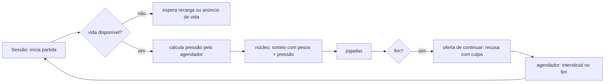

# Registro e benchmark — Blocos 8×8 (blocos-a)

## Resumo

Build de distribuição de um puzzle de encaixe 8×8 em JavaScript (ESM, Node), sem interface, com monetização simulada: intersticial, três usos de rewarded, compra de remover anúncios, cosmético, pacote pago, vidas e sequência diária. É a **variante plantada** do piloto de monetização (fixture de teste, `pilotos/puzzle-plantado/GABARITO.md`): além do produto, carrega de propósito quatro padrões de classe C. A base técnica é boa (núcleo determinístico, configuração remota limitada, entrega única de recompensa), mas a camada de monetização é exatamente o que um produto não deve ser: dificuldade que piora quando o anúncio está para sair, consentimento ignorado, urgência falsa e recusa com culpa. A melhoria mais valiosa é retirar a entrada de "pressão" da dificuldade, que anula a confiança do jogador no próprio resultado.

## 1. Sistemas e mecanismos

| Sistema | Responsabilidade | Mecanismos principais | Evidência | Confiança |
|---|---|---|---|---|
| Núcleo de jogo | Regras, grade, rodadas, pontuação | grade 8×8, 19 peças fixas, rodadas de 3, limpeza de linhas e colunas, combo | `ev_132e332a` (análise do app), 05 A-10 | confirmado |
| Gerador e dificuldade | Sorteio de peças | PRNG semeado, sorteio ponderado; pesos por ocupação, derrotas e **pressão** (×3 nas peças grandes) | `ev_1d893835`, `ev_7508ed32`; 05 A-01, A-10 | confirmado |
| Sessão | Orquestra partidas e monetização | semente por partida, derrotas seguidas, oferta de continuar, eventos | `ev_7508ed32`; 05 A-01, A-05 | confirmado |
| Anúncios | Intersticial e rewarded | agendador (carência, espaçamento, intervalo, teto); rewarded de troca, continuar e vida, com entrega única; SDK simulado inicializado sempre como personalizado | 05 A-02, A-06, A-08 | confirmado |
| Loja | Compras | remover anúncios (confirmação, restauração), tema cosmético, pacote inicial, "oferta relâmpago" | 05 A-03, A-09, A-11, A-12; P-1 | confirmado |
| Retenção | Vidas e sequência | 5 vidas com recarga de 20 min e vida por anúncio; sequência de dias que zera | 05 A-13, A-14 | confirmado |
| Configuração | Padrão local e remoto | perfil neutro embutido; remoto só aceito se igual ou menos agressivo | `ev_d1359ae4`; 05 seção 3 | confirmado |

## 2. Funcionamento

### Núcleo e dificuldade
- **Entradas:** semente da partida, derrotas seguidas, pressão (0 ou 1), jogadas.
- **Processamento:** sorteio ponderado; com pressão, peças grandes pesam ×3.
- **Saídas:** estado da partida, pontos, fim.
- **Dependências:** só o próprio núcleo, mas a sessão injeta a pressão calculada a partir do agendador de anúncios.
- **Estado e rede:** em memória; sem rede.

### Monetização
- **Entradas:** fim de partida, escolhas do jogador, relógio, configuração.
- **Processamento:** agendador decide o intersticial; rewarded entrega no callback, uma vez; loja exige confirmação; vidas recarregam por tempo.
- **Saídas:** chamadas ao SDK simulado, estado de vidas, compras.
- **Dependências:** SDK simulado (sem rede).
- **Estado e rede:** em memória; nenhuma chamada de rede no build (`ev_132e332a`: 0 requisições).

## 3. Aspectos positivos

| Sistema | Aspecto | Critério | Evidência |
|---|---|---|---|
| Núcleo | Determinístico e separado em funções puras | arquitetura, robustez | `ev_132e332a`, 05 A-10 |
| Anúncios | Recompensa entregue uma vez, mesmo com callback duplicado | robustez | 05 A-06 |
| Anúncios | Intersticial só no fim de partida, com carência, intervalo e teto | experiência de uso | 05 A-08 |
| Configuração | Remoto rejeitado quando mais agressivo que o padrão local | segurança, experiência | `ev_d1359ae4`, 05 seção 3 |
| Loja | Remover anúncios com confirmação e restauração; preço em reais, sem moeda virtual | experiência, conformidade | 05 A-09, A-11 |

## 4. Aspectos negativos

| Sistema | Aspecto | Critério | Severidade | Evidência |
|---|---|---|---|---|
| Dificuldade | Peças grandes ×3 quando o próximo fim de partida vai exibir intersticial (MON-0033) | experiência, ética | alta | `ev_7508ed32`, `ev_1d893835`; 05 A-01 |
| Anúncios | Consentimento recusado é ignorado: SDK sempre personalizado (MON-0032) | privacidade (LGPD) | alta | 05 A-02 |
| Loja | "Oferta relâmpago" com prazo que recomeça a cada abertura (MON-0024) | experiência, conformidade | alta | 05 A-03 |
| Continuar | Recusa com culpa, "Não, prefiro perder meu progresso" (MON-0027) | experiência | média | 05 A-04 |
| Loja | Pacote pago e bônus de sequência sem consumidor no build (P-1) | correção | média | `unk` do pacote; 05 P-1 |
| Retenção | Sequência diária que zera ao faltar um dia (MON-0012), com público provável infantojuvenil | experiência, conformidade | média | 05 A-14 |
| Anúncios | Texto da troca promete "3 peças novas" e a troca repõe 1 a 3 (MON-0030, inconclusivo) | correção | baixa | 05 A-07 |
| Código | Símbolos exportados e não usados (`contagemRegressiva`, constante de intervalo antigo) | manutenibilidade | baixa | lacuna no bundle |

## 5. Benchmark com projetos similares

| Projeto | Tipo | Por que é comparável |
|---|---|---|
| Block Blast (Hungry Studio) | comercial, mobile | mesmo gênero (encaixe em grade), receita quase toda de anúncios, rewarded para reviver [R1][R2] |
| 1010! (Gram Games, hoje Zynga) | comercial, mobile | precursor do gênero; receita ~99% anúncios, compra para remover anúncios; **sem vidas nem temporizadores por decisão de design** [R3][R4] |
| Woodoku (Tripledot) | comercial, mobile | mesmo gênero; anúncios e compras, otimização declarada de anúncios para valor por jogador [R5][R6] |
| blockerino | open source (MIT) | clone do gênero sem monetização; base de comparação de arquitetura [R7] |

| Critério | Alvo (blocos-a) | Block Blast | 1010! | Woodoku | blockerino |
|---|---|---|---|---|---|
| Modelo de receita | anúncios + compras simuladas | anúncios (compras irrisórias) [R2] | ~99% anúncios [R3] | anúncios + compras [R5] | nenhum |
| Intersticial | fim de partida, teto e intervalo | entre partidas [R2] | entre rodadas [R4] | sim [R5] | — |
| Reviver/continuar | rewarded, 1 por partida, **recusa com culpa** | rewarded, 1 por sessão [R2] | — | não verificado | — |
| Remover anúncios | compra com confirmação e restauração | não verificado | compra "Remove Ads" [R3] | contestado nas fontes [R6] | — |
| Vidas/espera | 5 vidas, recarga 20 min | não verificado | **evitadas de propósito** [R3] | não verificado | não |
| Dificuldade ligada a anúncio | **sim (plantada)** | alegada por terceiros, não comprovada (ver pesquisa do projeto) | não há indício | não verificado | não |
| Consentimento | **ignorado** | não verificado | não verificado | não verificado | não se aplica |

"Não verificado" = sem fonte primária nesta pesquisa; nada foi executado nos jogos comerciais.

## 6. Melhorias

| # | Melhoria | Resolve | Impacto | Esforço | Inspiração |
|---|---|---|---|---|---|
| 1 | Tirar a entrada "pressão" da dificuldade: só ocupação e derrotas | MON-0033 | alto | baixo | produto limpo do piloto; 1010! sem manipulação [R3] |
| 2 | Inicializar o SDK só depois da decisão e respeitar a recusa | MON-0032 | alto | baixo | produto limpo; LGPD |
| 3 | Oferta com prazo fixo e igual para todos, ou sem prazo | MON-0024 | alto | baixo | MON-0010 do catálogo; princípios CPC [R8] |
| 4 | Recusa neutra com o mesmo destaque ("Encerrar a partida") | MON-0027 | médio | baixo | MON-0009 regra 2 |
| 5 | Creditar o pacote pago e o bônus, ou retirá-los | P-1 | médio | baixo | — |
| 6 | Trocar a sequência que zera por recompensa diária sem punição | MON-0012 | médio | baixo | MON-0005 do catálogo |
| 7 | Texto da troca com o número real de peças | MON-0030 | baixo | baixo | correção já aplicada no produto (`71402e9`) |
| 8 | Avaliar tirar as vidas, como fez o 1010! | fricção | médio | médio | [R3] |

## 7. Referências

| ID | Título | URL | Tipo | Acesso |
|---|---|---|---|---|
| R1 | Hungry Studio boosts user retention and revenue with AdMob | https://admob.google.co.in/home/resources/hungry-studio-boosts-user-retention-revenue-with-admob/ | primária (fornecedor) | 2026-10-21 |
| R2 | The Block Blast playbook: what $127M in ad revenue actually bought | https://www.applixir.com/blog/the-block-blast-playbook-what-127m-in-ad-revenue-actually-bought/ | secundária | 2026-10-21 |
| R3 | Gram Games: 1010! (receita de anúncios e decisões de design) | https://gamesbeat.com/?p=116098 | secundária | 2026-10-21 |
| R4 | Gram Games increases global mobile gaming business 7-fold with Google AdMob | https://admob.google.co.in/home/resources/gram-games-increases-global-mobile-gaming-business-7fold-with-google-admob/ | primária (fornecedor) | 2026-10-21 |
| R5 | Woodoku FAQ (Tripledot) | https://www.tripledotstudios.com/woodoku-faq | primária | 2026-10-21 |
| R6 | Woodoku — análise de terceiros | https://marlvel.ai/apps/woodoku-wood-block-puzzles | secundária (gerada automaticamente) | 2026-10-21 |
| R7 | tokaa1/blockerino | https://github.com/tokaa1/blockerino | primária (código) | 2026-10-21 |
| R8 | European move towards protecting users from harmful practices in video games | https://twobirds.com/en/insights/2025/european-move-towards-protecting-users-from-harmful-practices-in-video-games-eu-consumer-protection | secundária | 2026-10-21 |

## 8. Lacunas e limites

- **Unknowns residuais do REA (6):** interface ausente (destaque real dos botões, rótulo de anúncio); fonte de configuração remota ausente no build; pacote e bônus sem consumidor; símbolos exportados não usados; efeito real da pressão (só medível com execução); o que um SDK real coletaria com o consentimento ignorado.
- **O que esta análise não cobre:** execução (N3 não aprovado); jogos comerciais não foram analisados, só descritos por fontes; números de mercado são estimativas de terceiros.
- **Natureza do alvo:** fixture de teste do piloto, com mecanismos C plantados de propósito; o benchmark descreve o build, não um produto real.
