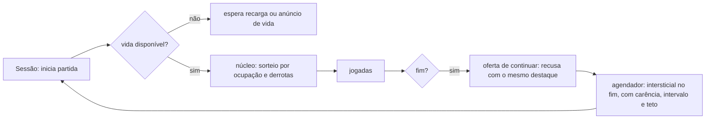

# Registro e benchmark — Blocos 8×8 (blocos-b)

## Resumo

Build de distribuição de um puzzle de encaixe 8×8 em JavaScript (ESM, Node), sem interface, com monetização simulada: intersticial, três usos de rewarded (trocar peças, continuar, ganhar vida), compra de remover anúncios e vidas. É o **build limpo** do piloto de monetização (controle de falso positivo, `pilotos/puzzle-plantado/GABARITO.md`). A análise não achou nenhum padrão de classe C. As forças são o núcleo determinístico e isolado, a configuração remota limitada pelo perfil e a entrega única de recompensa. As fraquezas apontadas pela análise (texto da troca, recarga remota sem teto, intervalo contado só entre intersticiais) já foram corrigidas no produto depois da análise (`71402e9`). Frente aos similares, a escolha que mais se destaca é ter vidas: o 1010! evitou vidas e temporizadores de propósito.

## 1. Sistemas e mecanismos

| Sistema | Responsabilidade | Mecanismos principais | Evidência | Confiança |
|---|---|---|---|---|
| Núcleo de jogo | Regras, grade, rodadas, pontuação | grade 8×8, 19 peças fixas, rodadas de 3, limpeza de linhas e colunas, combo | `ev_1617fde4` (análise do app), 05 A-07 | confirmado |
| Gerador e dificuldade | Sorteio de peças | PRNG semeado, sorteio ponderado por ocupação e derrotas seguidas; nenhuma entrada de monetização | `ev_a4ad0fd5`; 05 A-07 | confirmado |
| Sessão | Orquestra partidas e monetização | semente por partida, derrotas seguidas, oferta de continuar, eventos | `ev_1617fde4`; 05 A-03 | confirmado |
| Anúncios | Intersticial e rewarded | agendador (carência 2, a cada 2 partidas, 60 s, teto 5); rewarded com entrega única; SDK inicializado depois do consentimento | 05 A-01, A-02 | confirmado |
| Loja | Compras | remover anúncios com escopo, confirmação e restauração; preço em reais, sem moeda virtual | 05 A-04, A-05 | confirmado |
| Retenção | Vidas | 5 vidas, recarga de 20 min, até 3 vidas por anúncio por dia, sem venda | 05 A-06 | confirmado |
| Configuração | Padrão local e remoto | perfil neutro embutido; remoto só aceito se igual ou menos agressivo | `ev_1cfdc44c`; 05 seção 3 e P-01 | confirmado |

## 2. Funcionamento

### Núcleo e dificuldade
- **Entradas:** semente da partida, derrotas seguidas, jogadas.
- **Processamento:** sorteio ponderado; peças pequenas pesam mais com a grade cheia; peças grandes pesam menos depois de 2 derrotas.
- **Saídas:** estado da partida, pontos, fim.
- **Dependências:** só o próprio núcleo; a sessão não injeta estado de monetização.
- **Estado e rede:** em memória; sem rede.

### Monetização
- **Entradas:** fim de partida, escolhas do jogador, relógio, configuração.
- **Processamento:** agendador decide o intersticial; rewarded entrega no callback, uma vez; loja exige confirmação; vidas recarregam por tempo.
- **Saídas:** chamadas ao SDK simulado, estado de vidas, compras.
- **Dependências:** SDK simulado (sem rede).
- **Estado e rede:** em memória; nenhuma chamada de rede no build.

## 3. Aspectos positivos

| Sistema | Aspecto | Critério | Evidência |
|---|---|---|---|
| Núcleo | Sorteio depende só do jogo e do desempenho (MON-0033 verificado e não observado) | experiência, ética | `ev_a4ad0fd5`, 05 A-07 |
| Núcleo | Determinístico e em funções puras | arquitetura, robustez | `ev_1617fde4` |
| Anúncios | Consentimento decidido antes de inicializar o SDK | privacidade | 05 seção 6 |
| Anúncios | Entrega única de recompensa; intersticial só no fim de partida | robustez, experiência | 05 A-01, A-02 |
| Continuar | As três regras de MON-0009 declaradas: uma vez, recusa com o mesmo destaque, sem prazo | experiência | 05 A-03 |
| Configuração | Remoto limitado pelo perfil local, com registro do que foi rejeitado (P-01) | segurança, experiência | `ev_1cfdc44c`, 05 P-01 |
| Loja | Remover anúncios com confirmação e restauração; preço em reais | experiência, conformidade | 05 A-04, A-05 |

## 4. Aspectos negativos

| Sistema | Aspecto | Critério | Severidade | Evidência |
|---|---|---|---|---|
| Configuração | Recarga de vida remota com mínimo e sem teto: pode ficar lenta sem limite e empurrar o anúncio de vida (P-02) | experiência | média | 05 P-02 |
| Anúncios | Intervalo e teto contam só intersticiais: rewarded seguido de intersticial na mesma pausa (P-03) | experiência | média | 05 P-03 |
| Anúncios | Texto da troca promete "3 peças novas" e a troca repõe 1 a 3 (MON-0030, candidato) | correção | baixa | 05 A-08 |
| Retenção | Vidas (MON-0011, B) como fricção de sessão, num gênero em que o precursor evitou vidas | experiência | baixa | 05 A-06; [R3] |
| Build | Sem camada de interface: destaque real dos botões e rótulo de anúncio não verificáveis | cobertura | — | lacuna no bundle |

## 5. Benchmark com projetos similares

| Projeto | Tipo | Por que é comparável |
|---|---|---|
| Block Blast (Hungry Studio) | comercial, mobile | mesmo gênero, receita quase toda de anúncios, rewarded para reviver [R1][R2] |
| 1010! (Gram Games, hoje Zynga) | comercial, mobile | precursor do gênero; ~99% anúncios, remover anúncios pago, sem vidas nem temporizadores [R3][R4] |
| Woodoku (Tripledot) | comercial, mobile | mesmo gênero; anúncios e compras [R5][R6] |
| blockerino | open source (MIT) | clone do gênero sem monetização; arquitetura [R7] |

| Critério | Alvo (blocos-b) | Block Blast | 1010! | Woodoku | blockerino |
|---|---|---|---|---|---|
| Modelo de receita | anúncios + remover anúncios | anúncios (compras irrisórias) [R2] | ~99% anúncios [R3] | anúncios + compras [R5] | nenhum |
| Intersticial | fim de partida, carência, intervalo, teto | entre partidas [R2] | entre rodadas [R4] | sim [R5] | — |
| Reviver/continuar | rewarded, 1 por partida, recusa neutra | rewarded, 1 por sessão [R2] | — | não verificado | — |
| Remover anúncios | compra com confirmação e restauração | não verificado | compra "Remove Ads" [R3] | contestado nas fontes [R6] | — |
| Vidas/espera | 5 vidas, recarga 20 min, vida por anúncio | não verificado | evitadas de propósito [R3] | não verificado | não |
| Dificuldade ligada a anúncio | não (verificado no código) | alegada por terceiros, não comprovada | não há indício | não verificado | não |
| Limite do remoto | só menos agressivo que o local | não verificável de fora | não verificável | não verificável | — |

## 6. Melhorias

| # | Melhoria | Resolve | Impacto | Esforço | Inspiração | Situação |
|---|---|---|---|---|---|---|
| 1 | Teto para a recarga remota (20 a 40 min) | P-02 | médio | baixo | análise cega | **aplicada no produto** (`71402e9`) |
| 2 | Intervalo mínimo contando qualquer anúncio exibido | P-03 | médio | baixo | análise cega | **aplicada no produto** (`71402e9`) |
| 3 | Texto da troca com o número real de peças | MON-0030 | baixo | baixo | análise cega | **aplicada no produto** (`71402e9`) |
| 4 | Avaliar tirar as vidas e ficar só com anúncios no fim de partida e remover anúncios | fricção, MON-0011 | médio | médio | 1010! [R3] | proposta |
| 5 | Interface mínima para verificar destaque e rótulo de anúncio | lacuna | médio | médio | fase F7 do plano do piloto | proposta |

## 7. Referências

| ID | Título | URL | Tipo | Acesso |
|---|---|---|---|---|
| R1 | Hungry Studio boosts user retention and revenue with AdMob | https://admob.google.co.in/home/resources/hungry-studio-boosts-user-retention-revenue-with-admob/ | primária (fornecedor) | 2026-10-21 |
| R2 | The Block Blast playbook: what $127M in ad revenue actually bought | https://www.applixir.com/blog/the-block-blast-playbook-what-127m-in-ad-revenue-actually-bought/ | secundária | 2026-10-21 |
| R3 | Gram Games: 1010! (receita de anúncios e decisões de design) | https://gamesbeat.com/?p=116098 | secundária | 2026-10-21 |
| R4 | Gram Games increases global mobile gaming business 7-fold with Google AdMob | https://admob.google.co.in/home/resources/gram-games-increases-global-mobile-gaming-business-7fold-with-google-admob/ | primária (fornecedor) | 2026-10-21 |
| R5 | Woodoku FAQ (Tripledot) | https://www.tripledotstudios.com/woodoku-faq | primária | 2026-10-21 |
| R6 | Woodoku — análise de terceiros | https://marlvel.ai/apps/woodoku-wood-block-puzzles | secundária (gerada automaticamente) | 2026-10-21 |
| R7 | tokaa1/blockerino | https://github.com/tokaa1/blockerino | primária (código) | 2026-10-21 |

## 8. Lacunas e limites

- **Unknowns residuais do REA (6):** compra simulada (comportamento da loja real); invariância da sequência de peças só verificável em execução; valores remotos em produção; telas ausentes; o que um SDK real coletaria; se o texto da troca é o exibido.
- **Já resolvido fora da análise:** a invariância das peças ao estado de monetização é coberta pelo teste do produto (`reimplementacoes/puzzle-piloto/tests/invariancia.test.mjs`), que roda a sessão; a análise cega não tinha acesso a ele.
- **O que esta análise não cobre:** execução (N3 não aprovado); jogos comerciais não foram analisados, só descritos por fontes; números de mercado são estimativas de terceiros.
