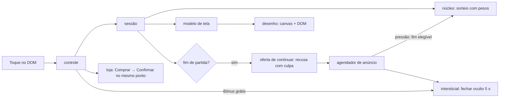

# Registro e benchmark — Encaixe 8×8 (encaixe-1)

## Resumo

Build web de um puzzle de encaixe 8×8 em JavaScript (ESM), com interface no navegador (canvas para grade e peças, DOM para botões), servidor local em `127.0.0.1` e monetização simulada:
- intersticial;
- três usos de rewarded;
- banner;
- remover anúncios (R$ 9,90);
- pacote e tema só no código;
- vidas e sequência diária.

É a **variante plantada** da F7 do piloto de monetização, uma fixture de teste com gabarito em `pilotos/puzzle-plantado/GABARITO.md`. Além do produto, ela carrega de propósito seis mecanismos de classe C no código e três na tela.

A base técnica é boa: núcleo determinístico, agendador com limites, configuração remota que só aceita valores mais restritivos, entrega única de recompensa e nenhuma rede externa. A camada de monetização é o oposto do que um produto deve ser: botão "Bônus grátis" que abre anúncio, fechar escondido e quase invisível, dificuldade que lê o anúncio e consentimento ignorado.

A melhoria mais valiosa é **separar anúncio de conteúdo**: tirar o botão disfarçado e o vínculo entre a dificuldade e o anúncio. Logo atrás vem a confirmação de compra atravessável por toque duplo, que este build herdou do produto limpo.

## 1. Sistemas e mecanismos

| Sistema | Responsabilidade | Mecanismos principais | Evidência | Confiança |
|---|---|---|---|---|
| Núcleo de jogo | Regras, grade, rodadas, pontos | grade 8×8, rodadas de 3 peças, limpeza de linhas e colunas | `ev_ac561df5…` (análise do app, 20 módulos) | confirmado |
| Gerador e dificuldade | Sorteio de peças | PRNG semeado; pesos por ocupação e derrotas (MON-0004); **peças grandes ×3 quando o fim da partida torna o intersticial elegível** (MON-0033) | `ev_ac561df5…`; 05 A-01, A-15 | confirmado no código; efeito não executado |
| Sessão | Orquestra partida, vidas e monetização | semente por partida, oferta de continuar, eventos de fim | `ev_ac561df5…`; 05 A-05, A-08 | confirmado |
| Anúncios | Intersticial, rewarded, banner | agendador (carência 2, ≥ 2 partidas, 60 s, teto 5); rewarded com entrega única; banner rotulado no rodapé; SDK simulado sempre personalizado (MON-0032) | 05 A-07 a A-09, A-12; capturas A e C (`ev_a7b97ff4…`, `ev_3de38e1b…`) | confirmado |
| Loja | Compras | remover anúncios com confirmação e restauração, escopo parcial; pacote e tema sem caminho na tela; oferta relâmpago dormente (MON-0024) | 05 A-06, A-10, A-16; captura B (`ev_00ddb138…`) | confirmado |
| Retenção | Vidas e sequência | 5 vidas, recarga de 20 min, +1 por anúncio até 3 por dia; sequência que zera, bônus nunca entregue | 05 A-13, A-14 | confirmado (consumo executado) |
| Configuração | Padrão local e remoto | `config.json`; remoto aceito só se igual ou mais restritivo; a interface não aplica remoto | 05 seção 3 | confirmado |
| Interface | Modelo de tela, desenho, controle | modelo de tela como dado puro; canvas para grade e peças, DOM para botões; janela de toque só no intersticial e no continuar; **"Bônus grátis" abre intersticial** (MON-0022); fechar oculto 5 s, depois "×" com contraste 1,20:1 (MON-0021) | 05 A-02, A-03; capturas A e B | confirmado (executado) |
| Servidor local | Entrega do build | HTTP estático em `127.0.0.1:8737`; 38 requisições por cenário, todas locais | capturas A, B e C | confirmado |

## 2. Funcionamento

### Núcleo, gerador e dificuldade
- **Entradas:** semente, ocupação da grade, derrotas seguidas e "pressão" vinda do agendador.
- **Processamento:** sorteio ponderado. Com pressão, as peças grandes pesam três vezes mais.
- **Saídas:** peças da rodada, estado da partida, pontos.
- **Dependências:** só o próprio núcleo, mas a sessão injeta a pressão calculada pela monetização.
- **Estado e rede:** em memória, sem rede.

### Monetização (anúncios, loja, retenção)
- **Entradas:** fim de partida, toques do jogador, relógio, configuração.
- **Processamento:**
  - o agendador decide o intersticial;
  - o rewarded entrega a recompensa uma vez, no fim do anúncio;
  - a loja pede confirmação e permite restaurar;
  - as vidas recarregam por tempo.
- **Saídas:** chamadas ao SDK simulado, estado de vidas e compras.
- **Dependências:** SDK simulado local.
- **Estado e rede:** em memória, sem rede externa no código nem na execução.

### Interface
- **Entradas:** toques no DOM; o canvas não recebe toque por localizador.
- **Processamento:** o controle traduz cada toque em ação da sessão, e o modelo de tela, como dado puro, descreve cena, botões, tempos e rótulos.
- **Saídas:** desenho em canvas e DOM.
- **Dependências:**
  - neste build, `interface/` importa direto do núcleo e da monetização, não só da sessão (achado 4 da review da U5);
  - o fechar do intersticial depende de `TEMPOS` (5000 ms);
  - a confirmação de compra usa o mesmo bloco de oferta do "Comprar", sem janela de toque.
- **Estado e rede:** em memória; servidor só local.

## 3. Aspectos positivos

| Sistema | Aspecto | Critério | Evidência |
|---|---|---|---|
| Núcleo | Determinístico, com semente e funções puras, reprodutível em execução | arquitetura, robustez | `ev_ac561df5…`; capturas com `semente=7` |
| Anúncios | Recompensa entregue uma vez; fechar cedo não entrega e não consome a troca | robustez, experiência | 05 A-09; captura C |
| Anúncios | Intersticial do agendador com carência, espaçamento, intervalo de 60 s contando qualquer anúncio e teto por sessão | experiência | 05 A-08 |
| Configuração | Remoto rejeitado quando mais agressivo que o padrão local | segurança, experiência | 05 seção 3 |
| Banner | Faixa própria no rodapé, rotulada e não tocável | experiência | 05 A-12; capturas A e C |
| Rede | Nenhuma chamada externa; servidor em loopback | privacidade, segurança | `ev_ac561df5…`; 38 requisições locais por cenário |
| Interface | Modelo de tela como dado puro, testável sem navegador | arquitetura, manutenibilidade | estrutura `src/interface/` no build; `ev_ac561df5…` |

## 4. Aspectos negativos

| Sistema | Aspecto | Critério | Severidade | Evidência |
|---|---|---|---|---|
| Interface | "Bônus grátis" abre intersticial sem bônus, fora do agendador e até depois da compra de remover anúncios (MON-0022) | experiência, ética, conformidade | alta | 05 A-02; capturas A e B |
| Interface | Fechar do intersticial oculto por 5 s sem aviso, depois "×" com contraste 1,20:1 (MON-0021) | experiência, acessibilidade | alta | 05 A-03; captura A |
| Dificuldade | Peças grandes ×3 na partida cujo fim libera o intersticial (MON-0033) | experiência, ética | alta | 05 A-01 (código; efeito não executado) |
| Anúncios | SDK sempre personalizado, ignorando o consentimento recebido (MON-0032) | privacidade (LGPD) | alta | 05 A-07 |
| Loja | Confirmação no mesmo ponto do "Comprar" e sem janela de toque: o toque duplo compra (MON-0025, não plantado; a análise deste alvo não achou) | experiência, conformidade | alta | comparação com o gabarito, nota 5 (`01-analise.md`); 05 A-11 |
| Loja | Preço não aparece em nenhuma tela da compra (MON-0006 falha) | conformidade (dever de informação) | média | 05 A-16; captura B |
| Loja | "Remover anúncios" mantém banner e o anúncio do bônus (MON-0003 com escopo parcial) | experiência, conformidade | média | 05 A-10; capturas B e C |
| Continuar | Recusa com culpa, "Não, prefiro perder meu progresso" (MON-0027) | experiência | média | 05 A-04, A-05 |
| Loja | Oferta relâmpago com prazo relativo à chamada, dormente (MON-0024) | conformidade | média | 05 A-06 |
| Retenção | Sequência que zera ao faltar um dia, com bônus calculado e nunca entregue (MON-0012, inconclusivo) | correção, experiência | baixa | 05 A-14 |
| Interface | Grade e peças só em canvas: não dá para jogar pelo teclado nem por automação por localizador | acessibilidade, testabilidade | média | lacunas `unk_2052376f…`, `unk_9b60d0ab…` |
| Interface | `interface/` importa do núcleo e da monetização, contornando a sessão | arquitetura | baixa | review da U5, achado 4 |

## 5. Benchmark com projetos similares

| Projeto | Tipo | Por que é comparável |
|---|---|---|
| Block Blast (Hungry Studio) | comercial, mobile | mesmo gênero; receita quase toda de anúncios; rewarded para reviver [R1][R2] |
| 1010! (Gram Games, hoje Zynga) | comercial, mobile | precursor do gênero; receita ~99% de anúncios; compra para remover anúncios; sem vidas nem temporizadores por decisão de design [R3][R4] |
| Woodoku (Tripledot) | comercial, mobile | mesmo gênero; anúncios e compras [R5][R6] |
| blockerino | open source (MIT) | clone do gênero sem monetização; base de arquitetura [R7] |

| Critério | Alvo (encaixe-1) | Block Blast | 1010! | Woodoku | blockerino |
|---|---|---|---|---|---|
| Modelo de receita | anúncios e compras simulados | anúncios, compras irrisórias [R2] | ~99% anúncios [R3] | anúncios e compras [R5] | nenhum |
| Intersticial | fim de partida com limites, **mais botão disfarçado** | entre partidas [R2] | entre rodadas [R4] | sim [R5] | — |
| Fechar do intersticial | oculto 5 s sem aviso, "×" com contraste 1,20:1 | não verificado | não verificado | não verificado | — |
| Referência do mercado para o fechar | — | AdMob admite até 5 s de atraso em intersticiais e pede o fechar longe do anúncio e de controles [R10]; contagem antes de fechar está entre os formatos abaixo do Better Ads Standard na web móvel [R11] | | | |
| Reviver/continuar | rewarded 1 por partida, **recusa com culpa** | rewarded 1 por sessão [R2] | — | não verificado | — |
| Remover anúncios | confirmação e restauração, escopo parcial, sem preço na tela | não verificado | "Remove Ads" [R3] | contestado nas fontes [R6] | — |
| Confirmação de compra | duas etapas no mesmo ponto, sem janela de toque | loja da plataforma | loja da plataforma | loja da plataforma | — |
| Vidas | 5, recarga de 20 min | não verificado | evitadas de propósito [R3] | não verificado | não |
| Dificuldade ligada a anúncio | **sim (plantada)** | alegada por terceiros, não comprovada | sem indício | não verificado | não |

"Não verificado" quer dizer que esta pesquisa não achou fonte primária. Nada foi executado nos jogos comerciais. Nos jogos de loja, a confirmação de cobrança é da plataforma, que desde 2014 deve obter consentimento expresso e informado antes de cobrar compras dentro do app [R9]. Uma confirmação própria atravessável, como a deste build, só não vira cobrança real porque a plataforma confirma de novo.

## 6. Melhorias

Ordenadas por impacto ÷ esforço.

| # | Melhoria | Resolve | Impacto | Esforço | Inspiração |
|---|---|---|---|---|---|
| 1 | Tirar o "Bônus grátis" ou fazê-lo entregar um bônus real, com rótulo de anúncio e dentro do agendador | MON-0022 | alto | baixo | produto limpo; rotular anúncios sem induzir o toque [R10] |
| 2 | Tirar a "pressão" da dificuldade: só ocupação e derrotas | MON-0033 | alto | baixo | produto limpo; 1010! [R3] |
| 3 | Inicializar o SDK só depois da decisão e respeitar a recusa | MON-0032 | alto | baixo | produto limpo; LGPD |
| 4 | Confirmação de compra com janela de toque e "Cancelar" no lugar do "Comprar" | MON-0025 | alto | baixo | já aplicado no produto (`f368265`); consentimento expresso [R9] |
| 5 | Fechar visível desde o início, ou contagem que diga a duração, com contraste ≥ 4,5:1 e alvo de pelo menos 24×24 px | MON-0021 | alto | baixo | já aplicado no produto (`f368265`); [R10][R11][R12] |
| 6 | Preço em moeda real no produto e na confirmação | MON-0006, MON-0003 | médio | baixo | já aplicado no produto (`f368265`) |
| 7 | Remover anúncios desligando todo anúncio forçado, banner incluso | MON-0003 | médio | baixo | catálogo MON-0003 |
| 8 | Recusa neutra com o mesmo destaque ("Encerrar a partida") | MON-0027, MON-0009 | médio | baixo | catálogo MON-0009, regra 2 (definição v3) |
| 9 | Grade e peças como botões no DOM, jogáveis pelo teclado | acessibilidade, testabilidade | médio | médio | já aplicado no produto (`f368265`) |
| 10 | Oferta com prazo fixo e igual para todos, ou sem prazo | MON-0024 | médio | baixo | catálogo MON-0010 |
| 11 | Tirar a sequência que zera, ou trocá-la por recompensa diária sem punição | MON-0012 | baixo | baixo | catálogo MON-0005 |

## 7. Referências

| ID | Título | URL | Tipo | Acesso |
|---|---|---|---|---|
| R1 | Hungry Studio boosts user retention and revenue with AdMob | https://admob.google.co.in/home/resources/hungry-studio-boosts-user-retention-revenue-with-admob/ | primária (fornecedor) | 2026-10-21 |
| R2 | The Block Blast playbook: what $127M in ad revenue actually bought | https://www.applixir.com/blog/the-block-blast-playbook-what-127m-in-ad-revenue-actually-bought/ | secundária | 2026-10-21 |
| R3 | Gram Games: 1010! (receita de anúncios e decisões de design) | https://gamesbeat.com/?p=116098 | secundária | 2026-10-21 |
| R4 | Gram Games increases global mobile gaming business 7-fold with Google AdMob | https://admob.google.co.in/home/resources/gram-games-increases-global-mobile-gaming-business-7fold-with-google-admob/ | primária (fornecedor) | 2026-10-21 |
| R5 | Woodoku FAQ (Tripledot) | https://www.tripledotstudios.com/woodoku-faq | primária | 2026-10-21 |
| R6 | Woodoku — análise de terceiros | https://marlvel.ai/apps/woodoku-wood-block-puzzles | secundária (gerada automaticamente) | 2026-10-21 |
| R7 | tokaa1/blockerino | https://github.com/tokaa1/blockerino | primária (código) | 2026-10-21 |
| R8 | European move towards protecting users from harmful practices in video games | https://twobirds.com/en/insights/2025/european-move-towards-protecting-users-from-harmful-practices-in-video-games-eu-consumer-protection | secundária | 2026-10-21 |
| R9 | FTC — declaração sobre o acordo com o Google sobre compras dentro do app (2014) | https://www.ftc.gov/system/files/documents/public_statements/580511/140904googleremarks.pdf | primária | 2026-10-26 |
| R10 | AdMob — interstitial ad guidance | https://support.google.com/admob/answer/6066980 | primária | 2026-10-26 |
| R11 | Google — About mobile ad experiences (Better Ads Standards) | https://support.google.com/webtools/answer/7073774 | primária | 2026-10-26 |
| R12 | W3C — Understanding SC 2.5.8 Target Size (Minimum), WCAG 2.2 | https://www.w3.org/WAI/WCAG22/Understanding/target-size-minimum.html | primária | 2026-10-26 |

Fontes de 2026-10-21 reaproveitadas do benchmark de `blocos-a` (mesmo gênero), sem nova consulta.

## 8. Lacunas e limites

- **Unknowns residuais do REA (3):**
  - efeito do gerador mais difícil antes do intersticial (`unk_2052376f…`);
  - personalização do SDK em execução (`unk_7c76c02e…`);
  - fluxos de fim de partida, sem vidas, oferta relâmpago e sequência, que não foram executados (`unk_9b60d0ab…`).
- **O que esta análise não cobre:**
  - **execução:** o cenário N3 só clica no centro de localizadores, e grade e peças estão no canvas, então nenhuma partida terminou;
  - **jogos comerciais:** não foram analisados, só descritos por fontes;
  - **lei e políticas de loja:** os textos não foram consultados;
  - **números de mercado:** são estimativas de terceiros.
- **Natureza do alvo:**
  - É uma fixture de teste com mecanismos C plantados de propósito. O benchmark descreve o build de 2026-10-23, conjunto `b3af6d82…3cff5d`.
  - O produto foi corrigido depois, no QA loop da F7 (`f368265`), e as melhorias 4, 5, 6 e 9 já estão nele. O build deste alvo não foi refeito.
- **Viés declarado:** a análise cega sabia, pelo `CLAUDE.md`, que existia uma variante plantada com classe C. Não sabia qual alvo era.
