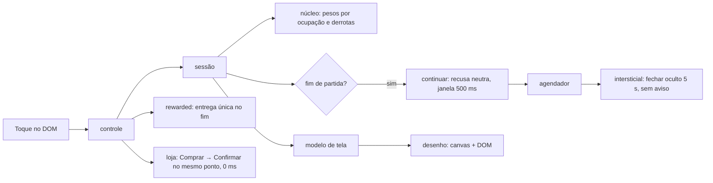

# Registro e benchmark — Encaixe 8×8 (encaixe-2)

## Resumo

Build web de um puzzle de encaixe 8×8 em JavaScript (ESM), com interface no navegador (canvas para grade e peças, DOM para botões), servidor local em `127.0.0.1` e monetização simulada:
- intersticial entre partidas;
- rewarded opcional (trocar peças, continuar, ganhar vida);
- vidas com recarga;
- compra única de remover anúncios.

Não tem banner, moeda virtual nem caixa paga. É o **produto limpo** da F7 do piloto de monetização: nada foi plantado, e o gabarito está em `pilotos/puzzle-plantado/GABARITO.md`.

A camada de monetização é contida: limites de frequência, recompensa entregue uma vez, consentimento falso por padrão, gerador que só lê desempenho, recusas neutras e nenhuma rede externa. Mesmo assim, a análise cega achou **dois defeitos reais que ninguém plantou**:
- a confirmação de compra nasce no ponto do "Comprar" e aceita toque na hora, então dois toques compram (MON-0025, reproduzido);
- o preço não aparece em nenhuma tela.

O fechar do intersticial oculto por 5 s sem aviso foi registrado como MON-0021. É o erro de classificação previsto pelo gabarito, que veio da ambiguidade do catálogo, mas a falta de aviso era real.

A melhoria mais valiosa é **confirmação com janela de toque e em outro ponto**, já aplicada no produto em `f368265`.

## 1. Sistemas e mecanismos

| Sistema | Responsabilidade | Mecanismos principais | Evidência | Confiança |
|---|---|---|---|---|
| Núcleo de jogo | Regras, grade, rodadas, pontos | grade 8×8, rodadas de 3 peças, limpeza de linhas e colunas | E1 `ev_2a869237…` | confirmado |
| Gerador e dificuldade | Sorteio de peças | PRNG semeado; pesos só por ocupação e derrotas seguidas (MON-0004); nenhuma leitura de estado de monetização no código | E1; 05 A-08 | confirmado no código; invariância não executada |
| Sessão | Orquestra partida, vidas e monetização | semente por partida, oferta de continuar 1 por partida, compra só com confirmação explícita | E1; 05 A-01, A-06 | confirmado |
| Anúncios | Intersticial e rewarded | agendador (carência 2, ≥ 2 partidas, 60 s contando todos os tipos, teto 5); rewarded com entrega única; rótulo "Anúncio"; SDK simulado exige consentimento decidido, falso por padrão | E1, E3 `ev_0a9983be…`; 05 A-04, A-05, A-07 | confirmado (rewarded executado) |
| Loja | Compra única | remover anúncios, não consumível, com restauração; R$ 9,90 só nos dados; confirmação no mesmo retângulo do "Comprar" | E1, E2 `ev_f5020eaf…`; 05 A-01, A-03 | confirmado (executado) |
| Retenção | Vidas | 5 vidas, recarga de 20 min (remoto 20–40), +1 por anúncio até 3 por dia | E1, E3; 05 A-09 | confirmado (consumo executado) |
| Configuração | Padrão local e remoto | `config.json`; `resolverConfig` só aceita remoto mais restritivo; a interface não aplica remoto | E1; 05 seção 3 | confirmado |
| Interface | Modelo de tela, desenho, controle | modelo de tela como dado puro; canvas para grade e peças, DOM para botões; janela de 500 ms só no intersticial e no continuar; fechar do intersticial oculto 5 s; fechar do rewarded imediato | E1, E2, E3; 05 A-01, A-02 | confirmado (loja e rewarded executados) |
| Servidor local | Entrega do build | HTTP estático em `127.0.0.1:8737`, ligado só durante as capturas | E2, E3 | confirmado |

## 2. Funcionamento

### Núcleo, gerador e dificuldade
- **Entradas:** semente, ocupação da grade e derrotas seguidas.
- **Processamento:** sorteio ponderado sem entrada de monetização.
- **Saídas:** peças da rodada, estado da partida, pontos.
- **Dependências:** nenhuma fora do núcleo.
- **Estado e rede:** em memória, sem rede.

### Monetização (anúncios, loja, vidas)
- **Entradas:** fim de partida, toques do jogador, relógio, configuração e consentimento (falso por padrão).
- **Processamento:**
  - o agendador decide o intersticial;
  - o rewarded entrega a recompensa no fim do anúncio, uma vez, e fechar antes não entrega;
  - a compra só acontece com confirmação explícita;
  - as vidas recarregam por tempo.
- **Saídas:** chamadas ao SDK simulado, vidas, compra.
- **Dependências:** SDK simulado local.
- **Estado e rede:** em memória; a captura só viu `127.0.0.1`.

### Interface
- **Entradas:** toques no DOM; o canvas não recebe toque por localizador.
- **Processamento:** o controle traduz cada toque em ação da sessão. O modelo de tela descreve cenas, botões, tempos e rótulos.
- **Saídas:** canvas e DOM.
- **Dependências:**
  - neste build, `interface/` importa direto do núcleo e da monetização (achado 4 da review da U5);
  - a etapa de confirmação da loja usa o mesmo bloco de oferta do "Comprar", sem `desde_ms`.
- **Estado e rede:** em memória; servidor só local.

## 3. Aspectos positivos

| Sistema | Aspecto | Critério | Evidência |
|---|---|---|---|
| Gerador | Pesos só por desempenho; nenhuma leitura de monetização no código | ética, experiência | E1; 05 A-08 |
| Anúncios | Rewarded com entrega única; fechar cedo não entrega e não consome a troca; oferta some depois de usada | robustez, experiência | E3; 05 A-04 |
| Anúncios | Intervalo de 60 s conta rewarded também; carência e teto por sessão | experiência | E1; 05 A-07 |
| Anúncios | SDK só inicializa com consentimento decidido, falso por padrão | privacidade | E1; 05 MON-0032 não observada |
| Ofertas | Recusas neutras ("Agora não", "Encerrar a partida"); sem prazo nem contagem | experiência | E1; 05 seção 4 |
| Continuar | Janela de 500 ms nos dois botões contra toque acidental | experiência, robustez | E1; 05 A-06 |
| Configuração | Remoto só mais restritivo; interface sem remoto | segurança | E1; 05 seção 3 |
| Rede | Nenhuma chamada externa | privacidade, segurança | E1, E2, E3 |
| Interface | Modelo de tela como dado puro, testável sem navegador | arquitetura | E1 |

## 4. Aspectos negativos

| Sistema | Aspecto | Critério | Severidade | Evidência |
|---|---|---|---|---|
| Loja | Confirmação no mesmo retângulo do "Comprar" (328×48 em y = 440), aceitando toque em 0 ms: dois toques compram (MON-0025) | experiência, conformidade | alta | E1, E2; 05 A-01 |
| Loja | Preço (R$ 9,90) ausente no produto e na confirmação (MON-0006 falha, MON-0003 abaixo da descrição) | conformidade (dever de informação) | média | E1, E2; 05 A-03 |
| Interface | Fechar do intersticial oculto 5 s sem texto nem contagem; por isso cai em MON-0021, pela definição v3 de "informado" | experiência | média | E1; 05 A-02 (não executado) |
| Interface | Janela de toque só em duas cenas, não em toda troca de tela | robustez | média | E1; review da U5, achado 5 |
| Continuar | Recusa cinza sem preenchimento ao lado do aceite azul preenchido: falha a regra 2 do MON-0009 pela definição v3 de "destaque" | experiência | baixa | E1; 05 A-06 |
| Rewarded | Duração do anúncio não informada; fechar antes perde a recompensa sem dizer quanto faltava | experiência | baixa | E3; 05 seção 5 |
| Interface | Grade e peças só em canvas: sem teclado nem automação por localizador | acessibilidade, testabilidade | média | lacunas `unk_7a677d85…`, `unk_2d066e5a…`, `unk_c5746200…` |
| Interface | `interface/` importa do núcleo e da monetização, contornando a sessão | arquitetura | baixa | review da U5, achado 4 |

## 5. Benchmark com projetos similares

| Projeto | Tipo | Por que é comparável |
|---|---|---|
| Block Blast (Hungry Studio) | comercial, mobile | mesmo gênero; anúncios com rewarded para reviver [R1][R2] |
| 1010! (Gram Games, hoje Zynga) | comercial, mobile | precursor do gênero; receita ~99% de anúncios; remover anúncios; sem vidas por decisão de design [R3][R4] |
| Woodoku (Tripledot) | comercial, mobile | mesmo gênero; anúncios e compras [R5][R6] |
| blockerino | open source (MIT) | clone sem monetização; base de arquitetura [R7] |

| Critério | Alvo (encaixe-2) | Block Blast | 1010! | Woodoku | blockerino |
|---|---|---|---|---|---|
| Modelo de receita | intersticial, rewarded e remover anúncios, simulados; sem banner | anúncios, compras irrisórias [R2] | ~99% anúncios [R3] | anúncios e compras [R5] | nenhum |
| Intersticial | só no fim de partida, carência, 60 s, teto 5 | entre partidas [R2] | entre rodadas [R4] | sim [R5] | — |
| Fechar do intersticial | oculto 5 s, sem aviso; 64×44 px, fora do anúncio | não verificado | não verificado | não verificado | — |
| Referência do mercado para o fechar | — | AdMob admite até 5 s de atraso e pede o fechar fora do anúncio e de controles [R10]; o alvo cumpre a posição, mas não informa a duração | | | |
| Reviver/continuar | rewarded 1 por partida, recusa neutra, janela 500 ms | rewarded 1 por sessão [R2] | — | não verificado | — |
| Remover anúncios | restauração e escopo claro, **sem preço na tela** | não verificado | "Remove Ads" [R3] | contestado nas fontes [R6] | — |
| Confirmação de compra | duas etapas, **atravessável por toque duplo** | loja da plataforma [R9] | loja da plataforma [R9] | loja da plataforma [R9] | — |
| Vidas | 5, recarga de 20 min, vida por anúncio | não verificado | evitadas de propósito [R3] | não verificado | não |
| Dificuldade ligada a anúncio | não observada no código | alegada por terceiros, não comprovada | sem indício | não verificado | não |
| Consentimento | falso por padrão, exigido antes de iniciar o SDK | não verificado | não verificado | não verificado | não se aplica |

"Não verificado" quer dizer que esta pesquisa não achou fonte primária. Nada foi executado nos jogos comerciais. A proteção contra cobrança acidental nos jogos de loja é a confirmação da plataforma, que desde 2014 deve obter consentimento expresso e informado antes de cobrar [R9]. A confirmação própria do alvo duplica essa camada, mas não protege sozinha.

## 6. Melhorias

Ordenadas por impacto ÷ esforço.

| # | Melhoria | Resolve | Impacto | Esforço | Inspiração |
|---|---|---|---|---|---|
| 1 | Confirmação com janela de toque e "Cancelar" no lugar do "Comprar" | MON-0025 | alto | baixo | já aplicado no produto (`f368265`); consentimento expresso [R9] |
| 2 | Preço em moeda real no produto e na confirmação | MON-0006, MON-0003 | médio | baixo | já aplicado no produto (`f368265`) |
| 3 | Aviso de duração no intersticial desde o início, ou fechar imediato | MON-0021 | médio | baixo | já aplicado no produto (`f368265`); [R10][R11] |
| 4 | Janela de toque em toda troca de tela | toque acidental | médio | baixo | já aplicado no produto (`f368265`) |
| 5 | Recusa com o mesmo estilo de preenchimento do aceite | MON-0009, regra 2 | baixo | baixo | já aplicado no produto (`f368265`); definição v3 do catálogo |
| 6 | Mostrar a duração do rewarded ("Recompensa em N s") | duração não informada | baixo | baixo | 05 seção 5 |
| 7 | Grade e peças como botões no DOM, jogáveis pelo teclado | acessibilidade, testabilidade | médio | médio | já aplicado no produto (`f368265`); alvos ≥ 24×24 px [R12] |
| 8 | Interface falando só com a sessão | arquitetura | baixo | médio | já aplicado no produto (`f368265`) |
| 9 | Avaliar tirar as vidas, como fez o 1010! | fricção (MON-0011, B) | médio | médio | [R3] |

## 7. Referências

| ID | Título | URL | Tipo | Acesso |
|---|---|---|---|---|
| R1 | Hungry Studio boosts user retention and revenue with AdMob | https://admob.google.co.in/home/resources/hungry-studio-boosts-user-retention-revenue-with-admob/ | primária (fornecedor) | 2026-10-21 |
| R2 | The Block Blast playbook: what $127M in ad revenue actually bought | https://www.applixir.com/blog/the-block-blast-playbook-what-127m-in-ad-revenue-actually-bought/ | secundária | 2026-10-21 |
| R3 | Gram Games: 1010! (receita de anúncios e decisões de design) | https://gamesbeat.com/?p=116098 | secundária | 2026-10-21 |
| R4 | Gram Games increases global mobile gaming business 7-fold with Google AdMob | https://admob.google.co.in/home/resources/gram-games-increases-global-mobile-gaming-business-7fold-with-google-admob/ | primária (fornecedor) | 2026-10-21 |
| R5 | Woodoku FAQ (Tripledot) | https://www.tripledotstudios.com/woodoku-faq | primária | 2026-10-21 |
| R6 | Woodoku — análise de terceiros | https://marlvel.ai/apps/woodoku-wood-block-puzzles | secundária (gerada automaticamente) | 2026-10-21 |
| R7 | tokaa1/blockerino | https://github.com/tokaa1/blockerino | primária (código) | 2026-10-21 |
| R9 | FTC — declaração sobre o acordo com o Google sobre compras dentro do app (2014) | https://www.ftc.gov/system/files/documents/public_statements/580511/140904googleremarks.pdf | primária | 2026-10-26 |
| R10 | AdMob — interstitial ad guidance | https://support.google.com/admob/answer/6066980 | primária | 2026-10-26 |
| R11 | Google — About mobile ad experiences (Better Ads Standards) | https://support.google.com/webtools/answer/7073774 | primária | 2026-10-26 |
| R12 | W3C — Understanding SC 2.5.8 Target Size (Minimum), WCAG 2.2 | https://www.w3.org/WAI/WCAG22/Understanding/target-size-minimum.html | primária | 2026-10-26 |

Os IDs seguem os do `encaixe-1/02-benchmark.md`; R8 não é usada aqui. Fontes de 2026-10-21 reaproveitadas do benchmark de `blocos-a`, sem nova consulta.

## 8. Lacunas e limites

- **Unknowns residuais do REA (4):**
  - continuar em execução (`unk_2d066e5a…`);
  - intersticial e o fechar dele em execução (`unk_7a677d85…`);
  - invariância do gerador ao estado de monetização (`unk_92e26666…`);
  - tela sem vidas e recarga (`unk_c5746200…`).
- **O que esta análise não cobre:**
  - **execução:** o cenário N3 só clica no centro de localizadores, e grade e peças estão no canvas, então nenhuma partida terminou;
  - **jogos comerciais:** não foram analisados, só descritos por fontes;
  - **lei e políticas de loja:** os textos não foram consultados;
  - **números de mercado:** são estimativas de terceiros.
- **Natureza do alvo:**
  - É uma fixture de teste, o build limpo de 2026-10-23, conjunto `986914ca…1770`.
  - O produto foi corrigido depois, no QA loop da F7 (`f368265`), e as melhorias 1 a 5, 7 e 8 já estão nele. O build deste alvo não foi refeito.
- **Viés declarado:** a análise cega sabia, pelo `CLAUDE.md`, que existia uma variante plantada com classe C. Não sabia qual alvo era.
