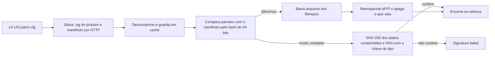

# Registro e benchmark — Ultima Online Classic (uo-classic)

## Resumo

O alvo tem dois programas nativos em C++: o patcher (`UO.exe`, Bioware Patch Client 1.0.6.5) e o cliente clássico (`client.exe` 7.0.117.33, Direct3D 9). Os dois compartilham uma camada de dados: o contêiner MYP (`.uop`, versões 4 e 5) e os pares `.idx`/`.mul`. O patcher baixa por HTTP um manifesto XML comprimido, compara os pacotes locais com ele e, no modo de verificação completa, confere uma assinatura RSA sobre o SHA-256 de cada arquivo. O cliente leva uma tabela de integridade do mapa que compara com o MD5 de cada bloco carregado e avisa o servidor quando diverge.

**Forças:**
- formatos simples e bem delimitados, com nomes por hash, compressão por entrada e ausência marcada no índice;
- assinatura de ponta a ponta por arquivo nos pacotes v5, que não depende do transporte;
- um id de tipo de chave gravado em cada assinatura, que permite trocar a chave sem mudar o formato;
- a mesma codificação de pixels nas animações antigas e novas.

**Fraquezas:**
- chave RSA de 1026 bits, abaixo do mínimo atual de 2048 [R9][R11], com preenchimento próprio em vez de um esquema padronizado [R10];
- só os pacotes v5 são assinados; os v4 da mesma instalação têm apenas Adler-32;
- transporte sem TLS e nenhuma proteção identificada contra manifesto antigo;
- tabela de integridade do mapa gerada de uma versão anterior do mapa;
- formatos sem versão no cabeçalho e sobras (`Granny.dll`, bloco de 32 bits sem uso aparente nas animações novas).

**Melhoria mais valiosa** para o PRKing_UO: um leitor tolerante às duas versões do contêiner e às variações de formato, com validações baratas (número do bloco, valor de 32 bits da entrada, trechos dentro da caixa do quadro). Se um dia houver distribuição de conteúdo próprio: metadados assinados com esquema padronizado e chave atual, no modelo do TUF [R3].

Evidência: `ev_…` e `unk_…` são registros do REA em `saidas/uo-classic/evidence.json` (104 registros, 10 lacunas). "P*n*" aponta a pergunta *n* do `01-analise.md`.

## 1. Sistemas e mecanismos

| Sistema | Responsabilidade | Mecanismos principais | Evidência | Confiança |
|---|---|---|---|---|
| Patcher | Manter o cliente atualizado | Configuração XML com produtos e repositórios; manifesto XML comprimido com cache; assinatura do produto (`.sig`); módulo HTTP; comparação dos pacotes com o manifesto por hash de 64 bits (ausente, a mais, comprimento, compressão, tamanho do metadado); no modo completo, RSA sobre o SHA-256 dos dados comprimidos, com chave escolhida pelo id do tipo; log por execução; cópia de si mesmo para reiniciar | P1–P4, `ev_352890f5…`, `ev_4c7a57bd…`, `ev_60203481…`, `ev_58b95a42…`, `ev_ee15b86b…` | confirmado; esquema do manifesto em aberto (`unk_57447042…`) |
| Chave de verificação | Validar a origem dos arquivos | Uma chave (tipo 21) montada byte a byte por um inicializador estático, módulo de 1026 bits, expoente 65537; preenchimento próprio (zeros, `FF`, digest, `FF`) | P2, P4, `ev_c79c2300…`, `ev_924e709a…`, `ev_05f07c1b…`, `unk_284a2435…` | confirmado (440 de 440 entradas v5) |
| Contêiner MYP (`.uop`) | Empacotar recursos do cliente | Tabelas encadeadas de entradas de 34 bytes; nome lógico por hash lookup3 em minúsculas; compressão por entrada (nenhuma ou zlib); metadado por entrada (v4: data e Adler-32; v5: assinatura e lookup3 do metadado) | P4, `ev_05c35663…`, `ev_47ffb61b…` | confirmado |
| Índice + dados (`.idx`/`.mul`) | Recursos legados | Entradas de 12 bytes; ausência por posição −1 ou tamanho ≤ 0; campo extra por tipo (nas luzes, largura e altura) | P5, `ev_4b11835e…`, `ev_dfdbb4a5…` | confirmado |
| Mapa e statics | Geometria do mundo | Blocos 8 × 8 por coluna, células por linha; número do bloco no cabeçalho; statics de 7 bytes com índice por bloco | P6 | confirmado |
| Checagem de integridade do mapa | Detectar mapa local alterado | Tabela embutida de 4 bits por bloco; MD5 dos 196 bytes do bloco; ligada pelo pacote `0xC6`; mensagem `0xC5` ao servidor quando diverge | P10, `ev_5dbae424…`, `ev_a47aecc3…`, `ev_ffd9e268…` | confirmado (mecanismo); inferido (origem da tabela) |
| Propriedades de tile e cor | Regras físicas e paletas | `tiledata` com flags de 64 bits em grupos de 32; `hues` em grupos de 8 paletas de 32 cores; cor 5-5-5 | P7, P8 | confirmado |
| Animações | Corpos, ações e quadros | Definições `.def` e `mobtypes.txt`; `AnimationSequence.uop`; `animdata.mul`; quadros por trechos (x, y, comprimento + índices de paleta, fim em `0x7FFF7FFF`) no `anim6` e no `AnimationFrame6.uop` (`AMOU`, paleta de 16 bits por quadro) | P9, `ev_135dd693…`, `ev_9b477f5e…`, `ev_ff7eb9de…` | confirmado |
| Criptografia do cliente | Protocolo e integridade | MD5 usado na checagem do mapa; tabelas de Twofish presentes, não seguidas | P10, `ev_5dbae424…` | confirmado (MD5); inferido (Twofish, só presença) |
| `Granny.dll` | Biblioteca de animação 3D | 258 exports; nenhum PE da cópia a importa ou carrega por nome | P10, `ev_193aba2c…`, `unk_9d3c0ce1…` | confirmado (sem uso) |

## 2. Funcionamento

### Patcher

- **Entradas:** `UO-patch.cfg` (XML com produtos, arquivos `.prod` e repositórios de manifesto); assinatura do produto (`.sig`); manifesto remoto; pacotes locais.
- **Processamento:** fluxo abaixo. A verificação da assinatura por arquivo só ocorre no modo completo.
- **Saídas:** pacotes MYP atualizados ou reempacotados; entradas apagadas quando saem do manifesto; log; cópia `UO.bin`.
- **Dependências:** WinHTTP, zlib 1.2.3 embutido, SHA-256 e aritmética RSA próprios, CryptoAPI só para números aleatórios. Nenhuma API de registro.
- **Estado e rede:** cache e arquivo de manifestos em disco. HTTP sem TLS para manifesto e arquivos, com uma URL global de reserva embutida.

### Contêiner e camada de dados

- **Entradas:** arquivos `.uop` e `.mul` da instalação.
- **Processamento:** o cliente monta o nome lógico (`build/`, recurso, número com zeros), calcula o hash e procura a entrada; pula o metadado e descomprime se preciso. Nos `.mul`, o índice dá posição e tamanho.
- **Saídas:** blocos de mapa, statics, flags, paletas, sequências e quadros de animação.
- **Dependências:** zlib; lookup3; Adler-32 (v4).
- **Estado e rede:** só leitura local. Atualizado pelo patcher.

### Checagem de integridade do mapa

- **Entradas:** bloco de mapa carregado (196 bytes); tabela embutida de 196.608 bytes; flag ligada pelo pacote `0xC6`.
- **Processamento:** MD5 do bloco; 4 bits de um byte do digest (byte 2 nos blocos pares, byte 4 nos ímpares) comparados com o nibble da tabela; uma vez por bloco.
- **Saídas:** mensagem `0xC5` com o número e o conteúdo do bloco quando diverge (envio ao servidor por inferência).
- **Estado e rede:** depende do servidor para ligar. A tabela bate só nas regiões que não mudaram desde uma versão anterior do mapa (27 % no `map0`, inferência sobre a origem).

## 3. Aspectos positivos

| Sistema | Aspecto | Critério | Evidência |
|---|---|---|---|
| Patcher | Assinatura por arquivo sobre os dados como estão no pacote: a integridade não depende do transporte nem de descomprimir antes de conferir | segurança, desempenho | P2, P4, `ev_58b95a42…`, `unk_284a2435…` |
| Patcher | Id do tipo de chave gravado em cada assinatura: dá para introduzir chave nova sem mudar o formato | segurança, manutenibilidade | P2, P4 |
| Patcher | Conferência estrutural contra o manifesto (ausente, a mais, comprimento, compressão, metadado) e limpeza do que saiu | robustez | P2, `ev_4c7a57bd…` |
| Patcher | Nenhuma escrita no registro; log por execução | privacidade, manutenibilidade | P3 |
| Contêiner MYP | Nome por hash e compressão por entrada permitem trocar um recurso sem reescrever o pacote | arquitetura, manutenibilidade | P4; P2 (repack de entradas) |
| Contêiner MYP | Valor de 32 bits da entrada cobre o metadado nas duas versões: checagem barata de corrupção | robustez | P4, `ev_ee15b86b…` |
| Contêiner MYP | Conteúdo legado guardado no `.uop` com o mesmo layout do `.mul` (`legacymul`); animações novas com a mesma codificação de pixels das antigas | manutenibilidade | P4, P6, P9 |
| Mapa | Número do bloco no cabeçalho dá checagem de integridade de graça | robustez | P6 |
| Índice + dados | Ausência marcada explicitamente; nenhuma entrada fora do arquivo; quadro vazio marcado por deslocamento 0 | robustez | P5, P9 |
| Configuração | Nenhum dado pessoal no `.cfg` do patcher (P01) | privacidade | P1, diário de 2026-10-28 |

## 4. Aspectos negativos

| Sistema | Aspecto | Critério | Severidade | Evidência |
|---|---|---|---|---|
| Chave de verificação | Módulo RSA de 1026 bits: abaixo dos 2048 bits que o NIST exige para gerar assinaturas desde 2014 [R9][R11]. Quem fatorar o módulo pode assinar pacotes que o patcher aceita | segurança | alta | P4, `ev_c79c2300…`, `unk_284a2435…` |
| Chave de verificação | Preenchimento próprio, fora dos esquemas do PKCS #1 (PKCS1-v1_5 ou PSS) [R10]; sem identificador de algoritmo de hash no bloco | segurança | média | P4, `ev_924e709a…` |
| Chave de verificação | Uma única chave registrada, montada no código: trocar exige novo `UO.exe` (o id do tipo ajuda, mas só existe o 21) | manutenibilidade, segurança | média | P4, `ev_05f07c1b…` |
| Patcher | Só os pacotes v5 têm assinatura; os v4 da mesma instalação (`map0x`, `AnimationFrame6`, `tileart`) só têm Adler-32, que não protege contra adulteração | segurança | média | P4, `unk_284a2435…` |
| Patcher | A assinatura por arquivo só é conferida no modo de verificação completa | segurança | média | P2, `ev_60203481…` |
| Patcher | Manifesto e arquivos por HTTP sem TLS; nenhum mecanismo identificado contra manifesto antigo (rollback) ou congelamento de atualização, que o TUF trata com metadados de tempo e snapshot [R3][R7]. O que a `.sig` do produto cobre não foi confirmado | segurança | média (o esquema do manifesto está em aberto) | P1, P2, `unk_57447042…` |
| Patcher e clientes | Sem `WinVerifyTrust`; clientes sem assinatura de código (só o patcher e o `patchui` são assinados) | segurança | média | P3; triagem do Adendo 1 (`00-seguranca.md`) |
| Checagem do mapa | Tabela gerada de uma versão anterior do mapa: com os dados atuais acusaria divergência na maior parte do mundo (inferência); MD5 truncado a 4 bits dá 1 chance em 16 de passar por acaso | robustez, segurança | média | P10, `ev_ffd9e268…`, `unk_8fe032e5…` |
| Contêiner MYP | Duas versões convivendo, com dois algoritmos para o valor de 32 bits (Adler-32 e lookup3) | manutenibilidade | baixa | P4 |
| Formatos `.mul` | Sem versão no cabeçalho: a largura dos flags do `tiledata` só se deduz pelo tamanho; `animdata` tem sobra no fim; o mapa tem um bloco a mais | robustez | baixa | P6, P7, P9 |
| Animações novas | Paleta repetida em cada quadro da mesma entrada; bloco de 256 valores de 32 bits no cabeçalho sem papel identificado | desempenho, manutenibilidade | baixa | P9, `unk_8b721263…` |
| Luzes | Ao recortar linhas no topo, o cliente multiplica as linhas puladas pela altura, não pela largura; só não aparece porque todas as luzes são quadradas | robustez | baixa | P5, `unk_3d62e92e…` |
| Cliente | `Granny.dll` distribuída sem uso | manutenibilidade | baixa | P10, `unk_9d3c0ce1…` |

## 5. Benchmark com projetos similares

| Projeto | Tipo | Por que é comparável |
|---|---|---|
| ClassicUO [R1] | Cliente aberto (BSD-2) para os mesmos dados | Lê a mesma instalação; referência direta para o leitor do PRKing_UO |
| UOFiddler / Ultima SDK [R2] | Editor aberto dos arquivos do cliente | Lê e escreve `.mul` e `.uop` (inclui um empacotador UOP); mostra o lado de escrita do formato |
| CASC, da Blizzard [R4][R5][R6] | Contêiner e entrega de conteúdo de jogo, comercial | Mesmo problema do MYP e do patcher: pacotes locais, manifesto e entrega incremental |
| The Update Framework [R3][R7] | Especificação aberta de atualização segura | Referência para o que um patcher deve garantir na verificação |

| Critério | Alvo | ClassicUO | UOFiddler | CASC | TUF |
|---|---|---|---|---|---|
| Endereçamento | Hash do nome lógico (lookup3) | Usa o do alvo | Usa o do alvo | Hash do conteúdo e manifesto raiz nome → hash [R4][R6] | Não se aplica (metadados de alvos com hash) |
| Compressão | Por entrada: nenhuma ou zlib | Lê a do alvo | Lê e escreve | Por bloco [R6] | Não se aplica |
| Integridade | v5: RSA sobre SHA-256 por arquivo; v4: Adler-32; cliente: MD5 de 4 bits por bloco de mapa | Não levantado | Não levantado | Pelo próprio endereçamento por conteúdo [R6] | Hashes e tamanhos em metadados assinados [R3] |
| Proteção contra versão antiga | Não identificada | Não se aplica | Não se aplica | Não levantado | Sim: papéis de timestamp e snapshot [R3][R7] |
| Gestão de chaves | Uma chave de 1026 bits no código, com id de tipo | Não se aplica | Não se aplica | Não levantado | Papéis separados, limiar de assinaturas, revogação [R3][R7] |
| Documentação pública | Nenhuma oficial | Código aberto | Código aberto | Só engenharia reversa da comunidade [R4][R5] | Especificação aberta [R3] |
| Plataformas | Windows | Windows, Linux, macOS, navegador [R1] | Windows (.NET) [R2] | Vários jogos e plataformas [R5] | Bibliotecas em várias linguagens [R7] |

## 6. Melhorias

Ordenadas por impacto ÷ esforço. "PRKing_UO" indica onde a melhoria se aplica no projeto nosso; o alvo não é nosso para corrigir.

| # | Melhoria | Resolve | Impacto | Esforço | Inspiração |
|---|---|---|---|---|---|
| 1 | Leitor do PRKing_UO aceita MYP v4 e v5, pula o metadado, confere o valor de 32 bits pela regra da versão e recusa compressão desconhecida com erro claro | versões convivendo | alto | baixo | P4; especificação §3.3 |
| 2 | Decodificador único de quadros por trechos para os dois formatos de animação, recusando trecho fora da caixa e tratando deslocamento 0 como quadro vazio | animações | alto | baixo | P9; especificação §3.8 |
| 3 | Validar barato: número do bloco do mapa, divisão exata do `tiledata`, limites de `animdata` e de largura × altura nas luzes (com passo pela largura) | formatos sem versão; recorte das luzes | médio | baixo | P5–P9 |
| 4 | Formatos do conteúdo próprio com cabeçalho de versão explícito, em vez de detecção por tamanho | formatos sem versão | médio | baixo | Cabeçalho do MYP (P4) |
| 5 | Se o PRKing_UO distribuir conteúdo próprio por rede: TLS e metadados assinados com esquema padronizado (RSA-PSS de 3072 bits ou Ed25519), timestamp e snapshot, no modelo do TUF; todos os pacotes assinados, não só os novos | chave fraca, preenchimento próprio, versão antiga, cobertura parcial | alto | médio | [R3][R7][R9][R10] |
| 6 | Pacote de conteúdo próprio endereçado por hash do conteúdo, com manifesto nome → hash | integridade e deduplicação | médio | médio | CASC [R4][R6] |
| 7 | Builds assinados (código) | clientes sem assinatura | médio | médio | Patcher assinado do alvo; ClassicUO listado no SignPath [R8] |
| 8 | Não reproduzir a checagem de integridade do mapa numa simulação local; se houver servidor próprio, conferir o mapa por hash completo do lado do servidor | tabela desatualizada, MD5 truncado | baixo | baixo | P10; especificação §3.5 |

## 7. Referências

| ID | Título | URL | Tipo | Acesso |
|---|---|---|---|---|
| R1 | ClassicUO — repositório oficial | https://github.com/ClassicUO/ClassicUO | primária (código-fonte) | 2026-10-28 |
| R2 | UOFiddler — site do projeto | https://uofiddler.polserver.com | primária (projeto) | 2026-10-28 |
| R3 | The Update Framework — especificação | https://github.com/theupdateframework/specification | primária (especificação) | 2026-10-28 |
| R4 | blizzget wiki — CASC storage | https://github.com/d07RiV/blizzget/wiki/CASC-storage | secundária (engenharia reversa) | 2026-10-28 |
| R5 | Warcraft Wiki — Content Addressable Storage Container | https://warcraft.wiki.gg/wiki/CASC | secundária | 2026-10-28 |
| R6 | cascette-rs — documentação do formato | https://cascette-rs.readthedocs.io | secundária | 2026-10-28 |
| R7 | go-tuf — wiki | https://github.com/theupdateframework/go-tuf/wiki | secundária (implementação) | 2026-10-28 |
| R8 | SignPath — projeto ClassicUO | https://signpath.org/projects/classicuo | secundária | 2026-10-28 |
| R9 | NIST publica a SP 800-131A Rev. 2 (transição de algoritmos e tamanhos de chave) | https://csrc.nist.gov/News/2019/NIST-Publishes-SP-800-131A-Rev-2 | primária (anúncio oficial) | 2026-10-29 |
| R10 | RFC 8017 — PKCS #1 v2.2: RSA Cryptography Specifications | https://www.rfc-editor.org/rfc/rfc8017 | primária (especificação) | 2026-10-29 |
| R11 | Thales Luna — NIST SP 800-131A Changes | https://thalesdocs.com/gphsm/luna/6.3/docs/usb/Content/administration/fips/NIST_SP_800_131A_Changes.htm | secundária (documentação de fornecedor) | 2026-10-29 |

As referências vieram de buscas por termos genéricos do domínio; nenhuma string, chave ou endereço do alvo saiu da máquina. Os resumos das páginas foram lidos pela busca; o texto completo da SP 800-131A, da RFC 8017, da especificação do TUF e o código dos projetos não foram abertos. O mínimo de 2048 bits desde 2014 vem do resumo de documentação de fornecedor [R11], coerente com o anúncio do NIST [R9]. Os formatos do alvo vêm só da análise local.

## 8. Lacunas e limites

- **Lacunas residuais do REA** (8 `resolved`, 2 `investigating`):
  - `unk_cef18757…` (`investigating`): bit 15 da cor na arte e nos gumps, fora da cópia. Nas paletas `AMOU` ele aparece em 3,6 % das cores, com significado não determinado.
  - `unk_57447042…` (`investigating`): esquema completo do manifesto e do `.prod`, e o que a `.sig` do produto cobre; o manifesto não está na cópia.
  - Resolvidas na reabertura: `unk_284a2435…` (metadado v5), `unk_8b721263…` (pixels `AMOU`), `unk_6830c229…` (entradas do `anim6`), `unk_bba627f1…` e `unk_8fe032e5…` (tabela da `.data`), `unk_9d3c0ce1…` (Granny), `unk_3d62e92e…` (luzes); `unk_c93a4147…` fora de alcance.
- **O que esta análise não cobre:**
  - protocolo de rede do cliente e uso do Twofish;
  - arte, gumps, som e os outros `AnimationFrame*.uop` (fora da cópia);
  - papel do bloco de 256 valores de 32 bits do cabeçalho `AMOU`;
  - mecânicas, assets e monetização, que têm protocolos próprios;
  - comportamento em execução (fora de N0/N1). A força real da chave de 1026 bits não foi testada: a severidade vem das diretrizes [R9][R11], não de tentativa de fatoração.
