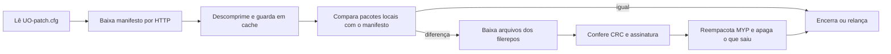

# Registro e benchmark — Ultima Online Classic (uo-classic)

## Resumo

O alvo tem dois programas nativos em C++: o patcher (`UO.exe`, Bioware Patch Client 1.0.6.5) e o cliente clássico (`client.exe` 7.0.117.33, Direct3D 9). Os dois compartilham uma camada de dados: o contêiner MYP (`.uop`) e os pares `.idx`/`.mul`. O patcher baixa por HTTP um manifesto XML comprimido, compara com os pacotes locais e confere CRC e assinatura por arquivo.

**Forças:** formatos simples, estáveis e bem delimitados, com nomes por hash, compressão por entrada e ausência marcada no índice. Os blocos do mapa trazem o próprio número, o que permite checar a integridade.

**Fraquezas:**
- transporte sem TLS;
- proteção contra versão antiga e congelamento de atualização não identificada;
- clientes sem assinatura de código;
- duas versões de contêiner convivendo, uma delas com metadado opaco;
- formatos sem versão no cabeçalho (`tiledata` detectado pelo tamanho);
- sobras como a `Granny.dll`.

**Melhoria mais valiosa** para o PRKing_UO: um leitor tolerante às duas versões do contêiner e às variações de formato, com validações baratas (número de bloco, divisão exata do tamanho). Se um dia houver distribuição de conteúdo próprio: transporte com TLS e metadados assinados no modelo do TUF [R3].

Evidência: `ev_…` e `unk_…` são registros do REA em `saidas/uo-classic/evidence.json`. "P*n*" aponta a pergunta *n* do `01-analise.md`.

## 1. Sistemas e mecanismos

| Sistema | Responsabilidade | Mecanismos principais | Evidência | Confiança |
|---|---|---|---|---|
| Patcher | Manter o cliente atualizado | Configuração XML com produtos e repositórios; manifesto XML comprimido com cache; módulo HTTP; comparação de pacotes com o manifesto; CRC de metadado e assinatura por arquivo; log por execução; cópia de si mesmo para reiniciar | P1–P3, `ev_352890f5…` | confirmado (fluxo); hipótese (algoritmos de verificação, `unk_57447042…`) |
| Contêiner MYP (`.uop`) | Empacotar recursos do cliente | Tabelas encadeadas de entradas de 34 bytes; nome lógico por hash lookup3 em minúsculas; compressão por entrada (nenhuma ou zlib); bloco de metadado por entrada (v4 com data e Adler-32; v5 opaco) | P4 | confirmado; v5 em parte (`unk_284a2435…`) |
| Índice + dados (`.idx`/`.mul`) | Recursos legados | Entradas de 12 bytes; ausência por posição −1; campo extra por tipo | P5 | confirmado |
| Mapa e statics | Geometria do mundo | Blocos 8 × 8 por coluna, células por linha; número do bloco no cabeçalho; statics de 7 bytes com índice por bloco | P6 | confirmado |
| Propriedades de tile e cor | Regras físicas e paletas | `tiledata` com flags de 64 bits em grupos de 32; `hues` em grupos de 8 paletas de 32 cores | P7, P8 | confirmado |
| Animações | Corpos e sequências | Definições `.def` e `mobtypes.txt`; `AnimationSequence.uop`; `animdata.mul` em grupos fixos | P9 | confirmado em parte; quadros em aberto (`unk_8b721263…`, `unk_6830c229…`) |
| Criptografia do cliente | Protocolo com o servidor | Tabelas públicas de Twofish e constantes de MD5 presentes | P10 | inferido (só presença) |
| Bloco de alta entropia da `.data` | Desconhecida | Tabela de 192 KiB, compatível com valores de 128 bits | P10, `unk_bba627f1…` | hipótese |
| `Granny.dll` | Biblioteca de animação 3D | 258 exports, nenhum uso estático | P10, `ev_193aba2c…`, `unk_9d3c0ce1…` | inferido (sobra) |

## 2. Funcionamento

### Patcher

- **Entradas:** `UO-patch.cfg` (XML com produtos, arquivos `.prod` e repositórios de manifesto); manifesto remoto; pacotes locais.
- **Processamento:** fluxo abaixo. A ordem exata das checagens não foi lida no código (provedor Ghidra indisponível).
- **Saídas:** pacotes MYP atualizados ou reempacotados; entradas apagadas quando saem do manifesto; log; cópia `UO.bin`.
- **Dependências:** WinHTTP, zlib 1.2.3 embutido, CryptoAPI só para números aleatórios. Nenhuma API de registro.
- **Estado e rede:** cache e arquivo de manifestos em disco. HTTP sem TLS para manifesto e arquivos, com uma URL global de reserva embutida.

### Contêiner e camada de dados

- **Entradas:** arquivos `.uop` e `.mul` da instalação.
- **Processamento:** o cliente monta o nome lógico (diretório `build/`, recurso, número com zeros), calcula o hash e procura a entrada; pula o metadado e descomprime se preciso. Nos `.mul`, o índice dá posição e tamanho.
- **Saídas:** blocos de mapa, statics, flags, paletas e sequências de animação.
- **Dependências:** zlib; lookup3; Adler-32 (v4).
- **Estado e rede:** só leitura local. Atualizado pelo patcher.

## 3. Aspectos positivos

| Sistema | Aspecto | Critério | Evidência |
|---|---|---|---|
| Contêiner MYP | Nome por hash e compressão por entrada permitem trocar um recurso sem reescrever o pacote | arquitetura, manutenibilidade | P4; P2 (repack de entradas) |
| Contêiner MYP | Conteúdo legado guardado dentro do `.uop` com o mesmo layout do `.mul` (`legacymul`), o que facilita a migração e mantém leitores antigos simples | manutenibilidade | P4, P6 |
| Mapa | Número do bloco no cabeçalho dá checagem de integridade de graça | robustez | P6 |
| Índice + dados | Ausência marcada explicitamente; nenhuma entrada fora do arquivo | robustez | P5 |
| Patcher | Verificação contra manifesto, CRC de metadado e assinatura por arquivo; limpeza do que saiu do manifesto | segurança, robustez | P2 |
| Patcher | Nenhuma escrita no registro; log por execução | privacidade, manutenibilidade | P3 |
| Configuração | Nenhum dado pessoal no `.cfg` do patcher (P01) | privacidade | P1, diário de 2026-10-28 |

## 4. Aspectos negativos

| Sistema | Aspecto | Critério | Severidade | Evidência |
|---|---|---|---|---|
| Patcher | Manifesto e arquivos por HTTP sem TLS; a confidencialidade e a defesa contra adulteração dependem só da verificação de assinatura, cujo algoritmo não foi lido | segurança | alta | P1, P2, `unk_57447042…` |
| Patcher | Nenhum mecanismo identificado contra entrega de manifesto antigo (rollback) ou congelamento de atualização; o TUF trata esses ataques com metadados de tempo e snapshot [R3][R7] | segurança | média (hipótese: pode existir no código não lido) | P2 |
| Patcher e clientes | Sem `WinVerifyTrust`; clientes sem assinatura de código (só o patcher e o `patchui` são assinados) | segurança | média | P3; triagem do Adendo 1 (`00-seguranca.md`) |
| Contêiner MYP | Versões 4 e 5 convivem na mesma instalação; o metadado da v5 é opaco | manutenibilidade, robustez | média | P4, `unk_284a2435…` |
| Formatos `.mul` | Sem versão no cabeçalho: a largura dos flags do `tiledata` só se deduz pelo tamanho; `animdata` tem sobra no fim; o mapa tem um bloco a mais | robustez | baixa | P6, P7, P9 |
| Cliente | Tabela de arquivos cita `.uop` que não existem na instalação; `Granny.dll` sem uso | manutenibilidade | baixa | P4, P10 |
| Cliente | MD5 presente (função de hash fraca para uso criptográfico); o uso exato não foi levantado | segurança | baixa (hipótese) | P10 |

## 5. Benchmark com projetos similares

| Projeto | Tipo | Por que é comparável |
|---|---|---|
| ClassicUO [R1] | Cliente aberto (BSD-2) para os mesmos dados | Lê a mesma instalação; referência direta para o leitor do PRKing_UO |
| UOFiddler / Ultima SDK [R2] | Editor aberto dos arquivos do cliente | Lê e escreve `.mul` e `.uop` (inclui um empacotador UOP); mostra o lado de escrita do formato |
| CASC, da Blizzard [R4][R5][R6] | Contêiner e entrega de conteúdo de jogo, comercial | Mesmo problema do MYP e do patcher: pacotes locais, manifesto e entrega incremental |
| The Update Framework [R3][R7] | Especificação aberta de atualização segura | Referência para o que um patcher deve garantir na verificação |

| Critério | Alvo | ClassicUO | UOFiddler | CASC | TUF |
|---|---|---|---|---|---|
| Endereçamento | Hash do nome lógico (lookup3) | Usa o do alvo | Usa o do alvo | Hash do conteúdo (chaves de 128 bits) e manifesto raiz nome → hash [R4][R6] | Não se aplica (metadados de alvos com hash) |
| Compressão | Por entrada: nenhuma ou zlib | Lê a do alvo | Lê e escreve | Por bloco [R6] | Não se aplica |
| Integridade | Adler-32 do metadado (v4), CRC e assinatura no patcher | Não levantado | Não levantado | Pelo próprio endereçamento por conteúdo [R6] | Hashes e tamanhos em metadados assinados [R3] |
| Proteção contra versão antiga | Não identificada | Não se aplica | Não se aplica | Não levantado | Sim: papéis de timestamp e snapshot [R3][R7] |
| Gestão de chaves | Não identificada | Não se aplica | Não se aplica | Não levantado | Papéis separados, limiar de assinaturas, revogação [R3][R7] |
| Documentação pública | Nenhuma oficial | Código aberto | Código aberto | Só engenharia reversa da comunidade [R4][R5] | Especificação aberta [R3] |
| Plataformas | Windows | Windows, Linux, macOS, navegador [R1] | Windows (.NET) [R2] | Vários jogos e plataformas [R5] | Bibliotecas em várias linguagens [R7] |

## 6. Melhorias

Ordenadas por impacto ÷ esforço. "PRKing_UO" indica onde a melhoria se aplica no projeto nosso; o alvo não é nosso para corrigir.

| # | Melhoria | Resolve | Impacto | Esforço | Inspiração |
|---|---|---|---|---|---|
| 1 | Leitor do PRKing_UO aceita MYP v4 e v5, pula o metadado e recusa compressão desconhecida com erro claro | versões convivendo | alto | baixo | P4; especificação §3.3 |
| 2 | Validar barato: número do bloco do mapa, divisão exata do `tiledata`, limites de `animdata` e de largura × altura nas luzes | formatos sem versão | médio | baixo | P5–P9 |
| 3 | Formatos do conteúdo próprio com cabeçalho de versão explícito, em vez de detecção por tamanho | formatos sem versão | médio | baixo | Cabeçalho do MYP (P4) |
| 4 | Se o PRKing_UO distribuir conteúdo próprio por rede: TLS e metadados assinados com timestamp e snapshot, no modelo do TUF | transporte sem TLS, versão antiga | alto | médio | [R3][R7] |
| 5 | Pacote de conteúdo próprio endereçado por hash do conteúdo, com manifesto nome → hash | integridade e deduplicação | médio | médio | CASC [R4][R6] |
| 6 | Builds assinados (código) | clientes sem assinatura | médio | médio | Patcher assinado do alvo; ClassicUO listado no SignPath [R8] |

## 7. Referências

| ID | Título | URL | Tipo | Acesso |
|---|---|---|---|---|
| R1 | ClassicUO — repositório oficial | https://github.com/ClassicUO/ClassicUO | primária (código-fonte) | 2026-10-28 |
| R2 | UOFiddler — site do projeto | https://uofiddler.polserver.com | primária (projeto) | 2026-10-28 |
| R3 | The Update Framework — especificação | https://github.com/theupdateframework/specification | primária (especificação) | 2026-10-28 |
| R4 | blizzget wiki — CASC storage | https://github.com/d07RiV/blizzget/wiki/CASC-storage | secundária (engenharia reversa) | 2026-10-28 |
| R5 | Warcraft Wiki — Content Addressable Storage Container | https://warcraft.wiki.gg/wiki/CASC | secundária | 2026-10-28 |
| R6 | cascette-rs — documentação do formato | https://cascette-rs.readthedocs.io | secundária | 2026-10-28 |
| R7 | go-tuf — wiki | https://github.com/theupdateframework/go-tuf/wiki | secundária (implementação) | 2026-10-28 |
| R8 | SignPath — projeto ClassicUO | https://signpath.org/projects/classicuo | secundária | 2026-10-28 |

As referências vieram de buscas por termos genéricos do domínio. Os resumos das páginas foram lidos pela busca; o texto completo da especificação do TUF e o código dos projetos não foram abertos. Os formatos do alvo vêm só da análise local.

## 8. Lacunas e limites

- **Lacunas residuais do REA** (todas `open`):
  - `unk_8b721263…` (`AnimationFrame*.uop`) e `unk_6830c229…` (`anim*.mul`): fora da cópia.
  - `unk_cef18757…`: bit 15 da arte.
  - `unk_bba627f1…`: propósito do bloco da `.data`.
  - `unk_9d3c0ce1…`: carga da Granny por nome montado em execução.
  - `unk_284a2435…`: metadado da v5.
  - `unk_c93a4147…`: nomes restantes do tileart e do MainMisc.
  - `unk_57447042…`: manifesto e algoritmos de verificação do patcher.
  - `unk_3d62e92e…`: ordem largura/altura no light.
- **O que esta análise não cobre:**
  - código descompilado, porque o provedor Ghidra do REA esteve indisponível;
  - protocolo de rede do cliente;
  - arte, gumps, som e animações (fora da cópia);
  - mecânicas, assets e monetização, que têm protocolos próprios;
  - comportamento em execução (fora de N0/N1).
